# 🌐 APIs & Asynchronous JavaScript

APIs (Application Programming Interfaces) and the Client-Server model are the backbone of the modern web. They allow developers to connect different services, fetch dynamic data, and build interactive applications. By leveraging **Asynchronous JavaScript**, we can fetch data, handle background tasks, and keep the user interface smooth and responsive.

---

## 📖 Chapter 1: What is an API?

### Core Concept

An **API (Application Programming Interface)** is a software intermediary that allows two applications to talk to each other. It allows your code to communicate with and leverage the features/data of someone else's code or service.

- **Browser/Web APIs:** Built-in tools provided directly by the web browser (e.g., `localStorage`, `fetch()`, Geolocation, DOM Manipulation).
- **Third-Party APIs:** External services run by other providers that you access over the web (e.g., BoredAPI, OpenWeatherMap, GitHub API).

### 💡 Visualizations

<details>
  <summary><b>📷 Expand to View API Visualizations & Slides</b></summary>
  <br>

### 1. What is an API?

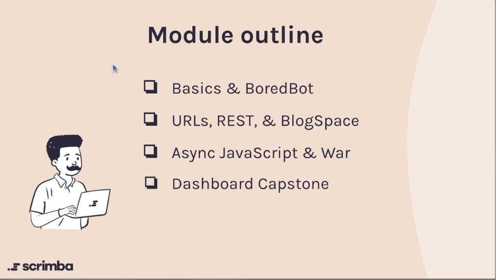

### 2. How APIs Connect Systems

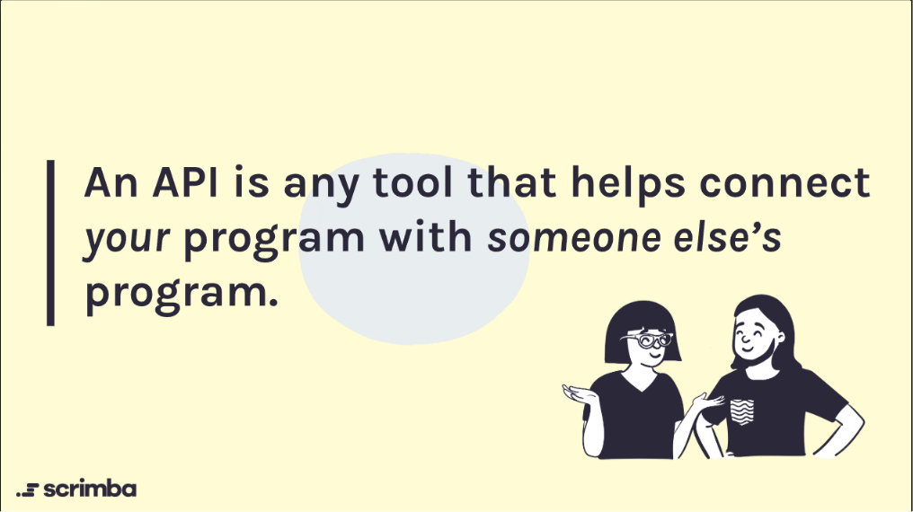

### 3. Web APIs on MDN

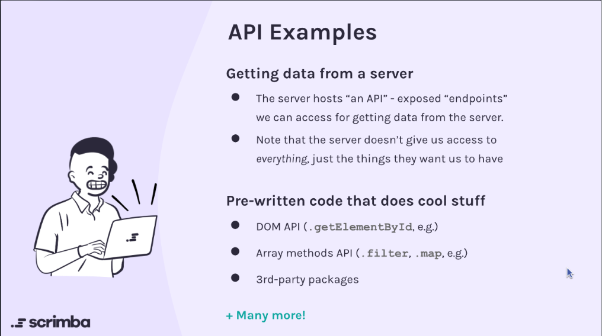

</details>

### 📝 Quiz & Recap

_(Original file: [quiz.md](<file:///c:/Users/suyas/Downloads/CODING%281%29/NEXTGEN-CODE/05-07-2026/APIs%20and%20Async%20JavaScript/Intro%20to%20APIs/What%20is%20an%20API/quiz.md>))_

> [!NOTE]
> **What does API stand for?**
>
> - **Answer:** **Application Programming Interface**

> [!TIP]
> **How would you describe an API in your own words?**
>
> - **Answer:** A tool or interface that allows your code to "talk" to and use the functionality or data of another program or service (e.g., Web APIs, third-party packages, etc.).

> [!IMPORTANT]
> **What are some examples of APIs you have used?**
>
> - **BoredAPI** - A web service to fetch random activity suggestions.
> - **Local Storage (localStorage)** - A built-in browser API to store data locally on the user's device.

### 🔗 Chapter 1 Resources

- 📄 **MDN Web Docs:** [MDN Web API Reference](https://developer.mozilla.org/en-US/docs/Web/API) - Learn about browser-provided Web APIs.

---

## 🖥️ Chapter 2: Clients & Servers

### Core Concept

The **Client-Server model** describes how computers interact over a network:

- **Client:** The device or application (like a web browser, phone, or laptop) that requests information or services.
- **Server:** A powerful computer or software system that stores data/services, listens for requests from clients, and responds with the requested data.

### 💡 Visualizations

<details>
  <summary><b>📷 Expand to View Clients & Servers Diagrams</b></summary>
  <br>

### 1. Clients & Servers Overview

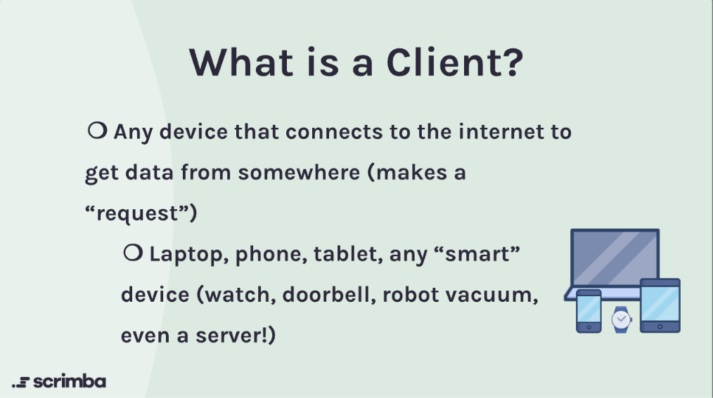

### 2. Client-Server Communication Flow

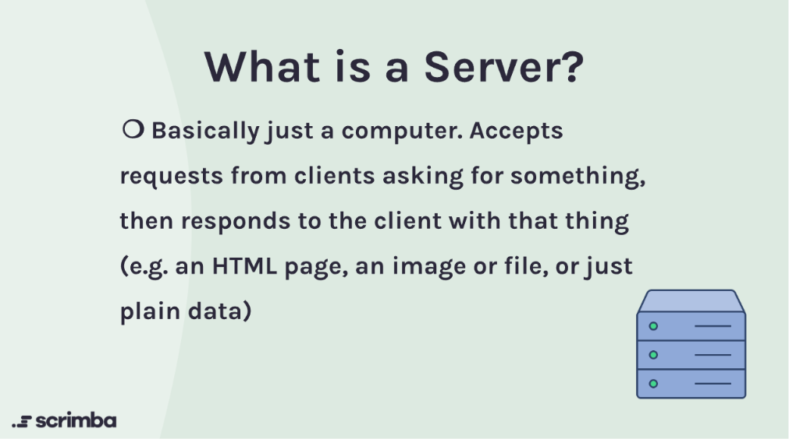

</details>

### 📝 Quiz & Recap

_(Original file: [quiz.md](<file:///c:/Users/suyas/Downloads/CODING%281%29/NEXTGEN-CODE/05-07-2026/APIs%20and%20Async%20JavaScript/Intro%20to%20APIs/Clients%20&%20Servers/quiz.md>))_

> [!NOTE]
> **What are some examples of "clients" you've used today?**
>
> - **Answer:** Laptop, phone, watch, smart TV, or web browser.

> [!TIP]
> **How would you explain what a "server" is to a 5-year-old?**
>
> - **Answer:** Imagine a big toy box in your friend’s house that has all the toys you like. When you visit, you ask, _"Can I have the car toy?"_ and your friend takes it from the box and gives it to you. The toy box is like the server: it keeps all the toys safe and gives the right toy when someone asks.

> [!IMPORTANT]
> **In what way do clients and servers interact with each other?**
>
> - **The Request-Response Cycle:** The client sends a **request** over the network saying what data or service it wants. The server receives the request, processes it (like searching a database or retrieving a file), and sends a **response** back.

### 🔗 Chapter 2 Resources

- 📄 **Vite Documentation:** [Vite Config Guide](https://vitejs.dev/) - How to configure build tooling for modern JS apps.
- 📄 **Scrimba Courses:** [Scrimba Course Portal](https://scrimba.com/courses) | [The Frontend Career Path](https://scrimba.com/fullstack-path-c0fullstack)

---

## 📨 Chapter 3: Requests & Responses

### Core Concept

In the web communication flow, a **Request** is initiated by the client to obtain files or data from a server, and the server returns a **Response** indicating success, redirection, client error, or server error using standardized status codes.

- **Client Requests:** A client can request code files (`index.html`, `style.css`, `script.js`) or data payloads (like a `JSON` file or API payload).
- **Server Responses:** The server's main job is to listen for requests, process them, and send back a response containing the status code and matching headers/body.

### 💡 Visualizations

<details>
  <summary><b>📷 Expand to View Requests & Responses Diagrams</b></summary>
  <br>

### 1. Requesting Files

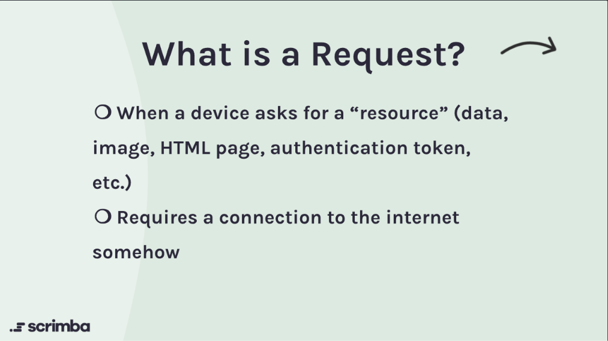

### 2. Request and Response Anatomy

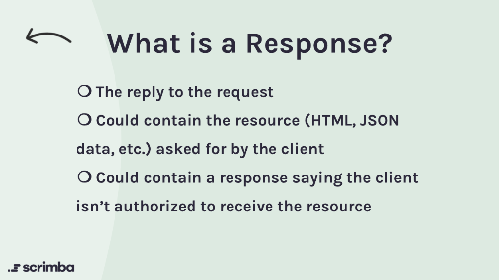

### 3. Server Response Processing

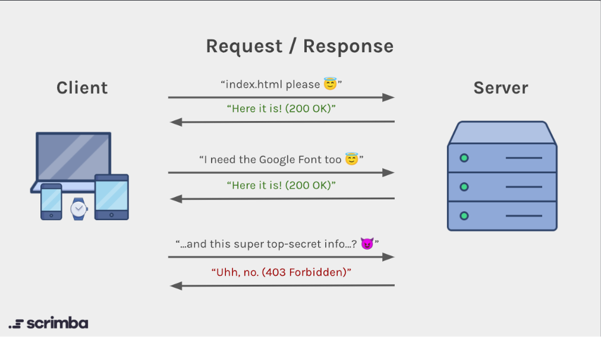

</details>

### 📝 Quiz & Recap

_(Original file: [quiz.md](<file:///c:/Users/suyas/Downloads/CODING%281%29/NEXTGEN-CODE/05-07-2026/APIs%20and%20Async%20JavaScript/Intro%20to%20APIs/Requests%20&%20Responses/quiz.md>))_

> [!NOTE]
> **What are 3 things your computer (client) might request from a server?**
>
> - **Answer:** `index.html`, `style.css`, `script.js`, or a `JSON` data payload.

> [!TIP]
> **What is the main job of a server?**
>
> - **Answer:** To listen to incoming requests, process them (e.g., fetch data from a database), and reply with a response. The client asks, and the server provides.

> [!IMPORTANT]
> **What are the classes of HTTP response status codes?**
>
> - **100 – 199:** Informational responses
> - **200 – 299 (Success):** E.g., `200 OK` (success), `201 Created` (resource created), `204 No Content` (success without body)
> - **300 – 399 (Redirection):** E.g., `301 Moved Permanently`, `302 Found`, `304 Not Modified` (use cache)
> - **400 – 499 (Client Errors):** E.g., `400 Bad Request` (syntax error), `401 Unauthorized`, `403 Forbidden`, `404 Not Found` (invalid URL/resource), `429 Too Many Requests` (rate limited)
> - **500 – 599 (Server Errors):** E.g., `500 Internal Server Error` (server crashed), `502 Bad Gateway`, `503 Service Unavailable` (overloaded), `504 Gateway Timeout`

### 🔗 Chapter 3 Resources

- 📄 **MDN Docs:** [HTTP Response Status Codes](https://developer.mozilla.org/en-US/docs/Web/HTTP/Status) - Details on all standard status codes.

---

## 🤖 Chapter 4: BoredBot Intro

### Core Concept

**BoredBot** (also styled as **HappyBot**) is a simple interactive web application that helps users find activities when they are bored. This project demonstrates how to make network requests to a third-party API and use the received data to dynamically update the web page.

Key technical implementation details:

- **The Fetch API:** Initiating an asynchronous request to BoredAPI: `fetch("https://www.boredapi.com/api/activity")`.
- **Promise Chaining:** Handling the response stream using `.then(res => res.json())` to parse the payload as JSON, and a subsequent `.then(data => ...)` to access the activity data.
- **DOM Modification:** Dynamically inserting `data.activity` into the page, changing text headings, and updating CSS classes on body click.

### 💻 Code Implementation

You can explore the source files for BoredBot below:

- [index.html](<file:///c:/Users/suyas/Downloads/CODING%281%29/NEXTGEN-CODE/05-07-2026/APIs%20and%20Async%20JavaScript/Intro%20to%20APIs/BoredBot%20Intro/index.html>) - Structural markup containing the bot trigger button and placeholder text.
- [index.js](<file:///c:/Users/suyas/Downloads/CODING%281%29/NEXTGEN-CODE/05-07-2026/APIs%20and%20Async%20JavaScript/Intro%20to%20APIs/BoredBot%20Intro/index.js>) - JavaScript logic handling event listeners, API fetch promises, and DOM updates.
- [index.css](<file:///c:/Users/suyas/Downloads/CODING%281%29/NEXTGEN-CODE/05-07-2026/APIs%20and%20Async%20JavaScript/Intro%20to%20APIs/BoredBot%20Intro/index.css>) - Styling sheet containing the visual themes (including the `.fun` body class theme).

```javascript
// BoredBot index.js snippet
document.getElementById("bored-bot").addEventListener("click", getIdea);

function getIdea() {
  fetch("https://www.boredapi.com/api/activity")
    .then((res) => res.json())
    .then((data) => {
      document.body.classList.add("fun");
      document.getElementById("idea").textContent = data.activity;
      document.getElementById("title").textContent = "🦾 HappyBot🦿";
    });
}
```

### 🔗 Chapter 4 Resources

- 📄 **MDN Web Docs:** [Using the Fetch API](https://developer.mozilla.org/en-US/docs/Web/API/Fetch_API/Using_Fetch) - Overview and guides on using `fetch()`.
- 📄 **API Endpoint:** [BoredAPI Activity Endpoint](https://www.boredapi.com/api/activity)

---

## 📄 Chapter 5: JSON Review

### Core Concept

**JSON (JavaScript Object Notation)** is a lightweight text-based data-interchange format that is language-independent. It is widely used to transmit data in web applications (e.g., sending data from a server to a client so it can be parsed and rendered).

Key syntax rules of JSON compared to standard JS Objects:

- **Double Quotes Required:** All property names (keys) and string values must be enclosed in double quotes (e.g., `"name": "Sarah"`). Single quotes are invalid.
- **No Trailing Commas:** The last element in an array or object must not end with a trailing comma.
- **Supported Data Types:** Strings, Numbers, JSON Objects, Arrays, Booleans (`true`/`false`), and `null`. (Functions, dates, and `undefined` are not supported).
- **No Comments:** JSON files do not support code comments.

### 💡 Visualizations

<details>
  <summary><b>📷 Expand to View JSON Concepts & Validation Diagrams</b></summary>
  <br>

### 1. JSON Format & Structure

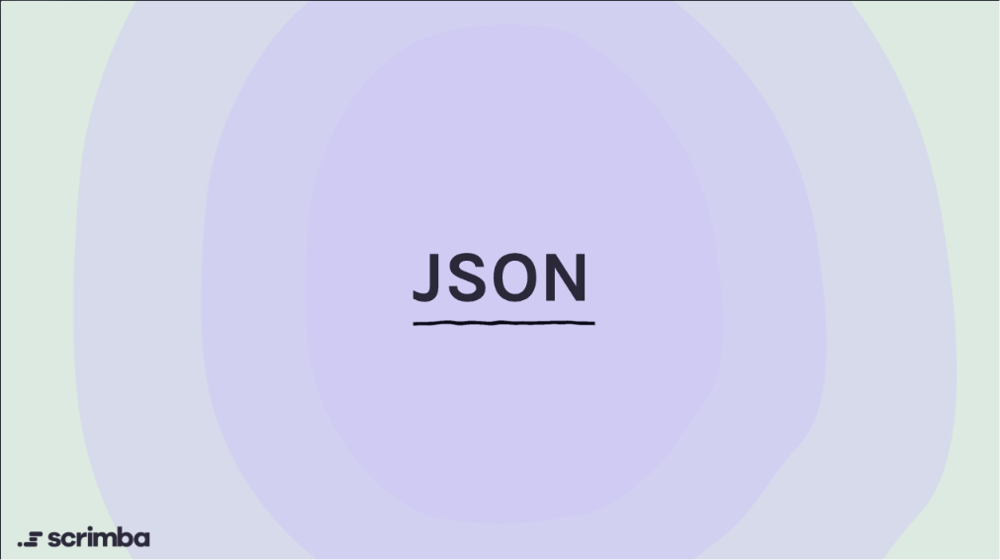

### 2. JSON Syntax Rules

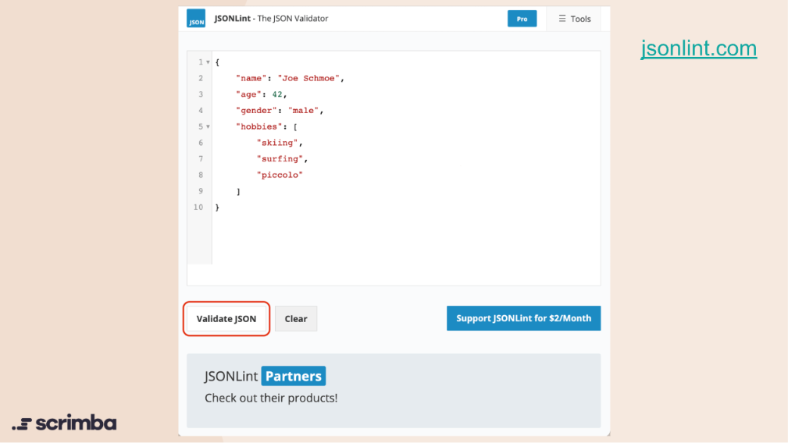

### 3. Validating JSON Data

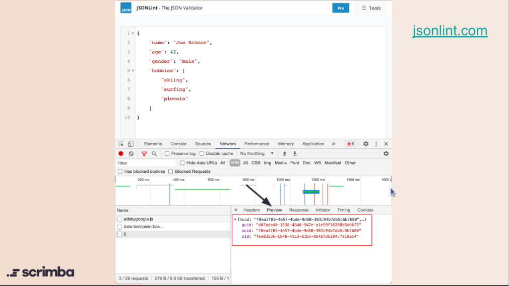

</details>

### 💻 Code Examples

You can review the sample JSON files below:

- [person.json](<file:///c:/Users/suyas/Downloads/CODING%281%29/NEXTGEN-CODE/05-07-2026/APIs%20and%20Async%20JavaScript/Intro%20to%20APIs/JSON%20Review/person.json>) - Simple single object representation.
- [people.json](<file:///c:/Users/suyas/Downloads/CODING%281%29/NEXTGEN-CODE/05-07-2026/APIs%20and%20Async%20JavaScript/Intro%20to%20APIs/JSON%20Review/people.json>) - Array containing multiple JSON objects.

### 🔗 Chapter 5 Resources

- 🛠️ **JSON Validator:** [JSONLint](https://jsonlint.com/) - The free online validator and reformatting tool for JSON.
- 📄 **MDN Web Docs:** [Working with JSON](https://developer.mozilla.org/en-US/docs/Learn/JavaScript/Objects/JSON) - Guide to parsing, generating, and manipulating JSON in JS.

---

## 🐶 Chapter 6: First Fetch

### Core Concept

In this chapter, we write our very first `fetch()` request from scratch to retrieve data from a public API.

Key technical steps:

- **Fetching Data:** We initiate a request to the Dog API endpoint: `fetch("https://dog.ceo/api/breeds/image/random")`.
- **Parsing the Response:** Since the response comes back as a stream, we parse it into a JavaScript object using `.then(response => response.json())`.
- **Handling the Data:** Finally, we chain another `.then(data => console.log(data))` to access the actual JSON payload and print it to the console.

### 💡 Visualizations

<details>
  <summary><b>📷 Expand to View Fetch & Promises Diagrams</b></summary>
  <br>

### 1. Understanding Fetch

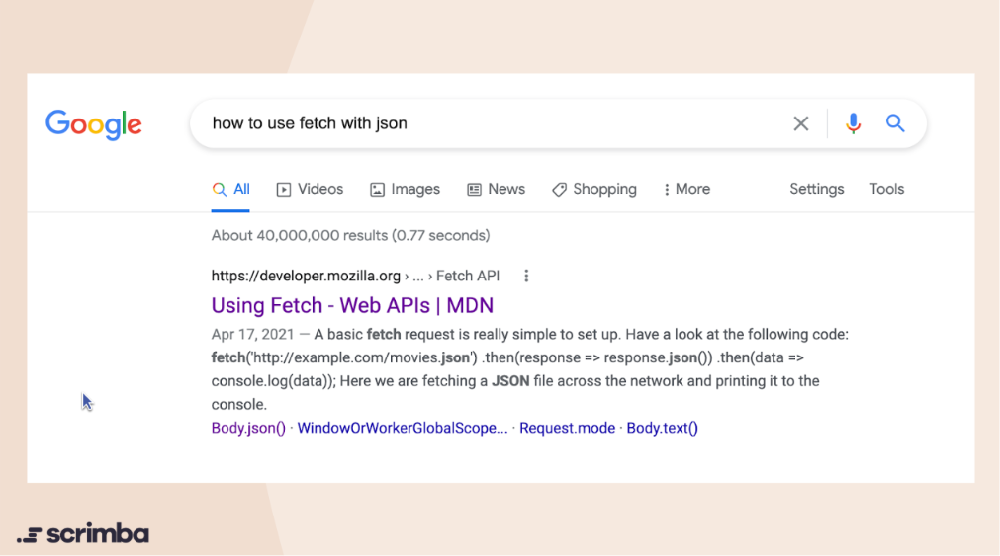

### 2. Fetch Response & JSON

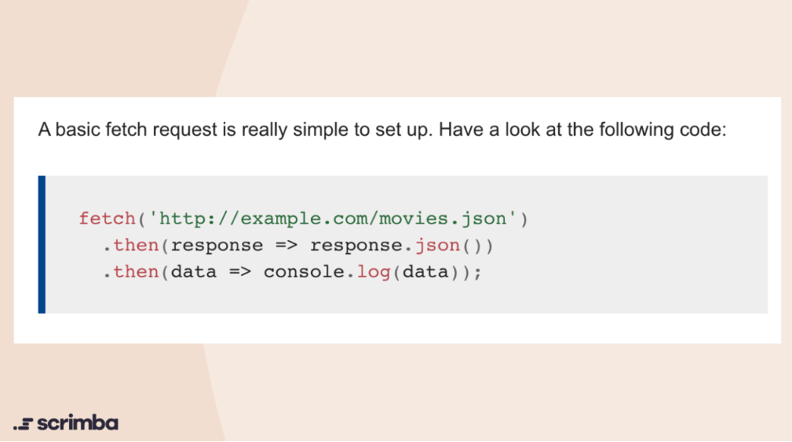

</details>

### 💻 Code Implementation

You can explore the source files for this practice below:

- [index.html](<file:///c:/Users/suyas/Downloads/CODING%281%29/NEXTGEN-CODE/05-07-2026/APIs%20and%20Async%20JavaScript/Intro%20to%20APIs/First%20fetch/index.html>) - Basic markup structure.
- [index.js](<file:///c:/Users/suyas/Downloads/CODING%281%29/NEXTGEN-CODE/05-07-2026/APIs%20and%20Async%20JavaScript/Intro%20to%20APIs/First%20fetch/index.js>) - The JavaScript file containing the fetch request logic.

```javascript
// First Fetch snippet
fetch("https://dog.ceo/api/breeds/image/random")
  .then((response) => response.json())
  .then((data) => console.log(data));
```

### 🔗 Chapter 6 Resources

- 📄 **API Endpoint:** [Dog API Random Image](https://dog.ceo/api/breeds/image/random)

---

## ⏱️ Chapter 7: `.then()` & Asynchronous JavaScript

### Core Concept

In this chapter, we explore how **Asynchronous JavaScript** works in practice.

When we use `fetch()`, JavaScript doesn't stop and wait for the API response. Instead, it moves on to execute the rest of the synchronous code (like `console.log()` statements and `for` loops). It handles the API response asynchronously once the data actually arrives via the `.then()` method. This non-blocking behavior is what keeps web applications fast and responsive.

### 💻 Code Implementation

You can explore the source files for this practice below:

- [index.html](<file:///c:/Users/suyas/Downloads/CODING%281%29/NEXTGEN-CODE/05-07-2026/APIs%20and%20Async%20JavaScript/Intro%20to%20APIs/.thenO%20and%20Asynchronous%20JavaScript/index.html>) - Basic markup structure.
- [index.js](<file:///c:/Users/suyas/Downloads/CODING%281%29/NEXTGEN-CODE/05-07-2026/APIs%20and%20Async%20JavaScript/Intro%20to%20APIs/.thenO%20and%20Asynchronous%20JavaScript/index.js>) - JavaScript file demonstrating the non-blocking, asynchronous behavior of `fetch` compared to standard synchronous code like `console.log()` and `for` loops.

```javascript
// Asynchronous behavior demonstration
console.log("The first console log");

fetch("https://dog.ceo/api/breeds/image/random")
  .then((response) => response.json())
  .then((data) => console.log(data));

console.log("The second console log");

for (let i = 0; i < 100; i++) {
  console.log("I'm inside the for loop");
}
```

---

## 🐕 Chapter 8: Dog API Fetch and DOM Practice

### Core Concept

In this chapter, we combine the Fetch API with DOM manipulation. We make an API request to retrieve a random dog image URL and dynamically insert it into the webpage.

Key technical steps:

- **Fetching Data:** Requesting data from the Dog API.
- **Accessing the DOM:** Targeting an element (like a `<div>`) using `document.getElementById()`.
- **Updating HTML:** Using `.innerHTML` to insert an `` tag where the `src` attribute is dynamically set using template literals containing the fetched image URL (`${data.message}`).

### 💻 Code Implementation

You can explore the source files for this practice below:

- [index.html](<file:///c:/Users/suyas/Downloads/CODING%281%29/NEXTGEN-CODE/05-07-2026/APIs%20and%20Async%20JavaScript/Intro%20to%20APIs/Dog%20API%20Fetch%20and%20DOM%20Practice/index.html>) - Markup containing the empty `#image-container` div.
- [index.js](<file:///c:/Users/suyas/Downloads/CODING%281%29/NEXTGEN-CODE/05-07-2026/APIs%20and%20Async%20JavaScript/Intro%20to%20APIs/Dog%20API%20Fetch%20and%20DOM%20Practice/index.js>) - JavaScript logic fetching the image and appending it to the DOM.

```javascript
// Fetch and DOM Manipulation
fetch("https://dog.ceo/api/breeds/image/random")
  .then((response) => response.json())
  .then((data) => {
    console.log(data);
    document.getElementById("image-container").innerHTML = `
            
        `;
  });
```

### 🔗 Chapter 8 Resources

- 📄 **API Endpoint:** [Dog API Random Image](https://dog.ceo/api/breeds/image/random)

---

## 💡 Chapter 9: Fetch idea from Bored API

### Core Concept

In this chapter, we reinforce our knowledge of the Fetch API by connecting to the Bored API (via Scrimba's proxy). We request a random activity and update the text content of a DOM element to display the fetched idea.

Key technical steps:

- **Fetching Data:** Requesting data from the Bored API (`https://apis.scrimba.com/bored/api/activity`).
- **Handling JSON:** Converting the response stream into JSON format.
- **Updating Text Content:** Extracting the `activity` property from the returned JSON object and setting it as the `.textContent` of our `#activity-name` element in the DOM.

### 💻 Code Implementation

You can explore the source files for this practice below:

- [index.html](<file:///c:/Users/suyas/Downloads/CODING%281%29/NEXTGEN-CODE/05-07-2026/APIs%20and%20Async%20JavaScript/Intro%20to%20APIs/Fetch%20idea%20from%20Bored%20API/index.html>) - Markup containing the empty `#activity-name` heading.
- [index.js](<file:///c:/Users/suyas/Downloads/CODING%281%29/NEXTGEN-CODE/05-07-2026/APIs%20and%20Async%20JavaScript/Intro%20to%20APIs/Fetch%20idea%20from%20Bored%20API/index.js>) - JavaScript logic fetching the activity and injecting the text into the DOM.

```javascript
// Fetch activity from Bored API
fetch("https://apis.scrimba.com/bored/api/activity")
  .then((response) => response.json())
  .then((data) => {
    console.log(data);
    document.getElementById("activity-name").textContent = data.activity;
  });
```

### 🔗 Chapter 9 Resources

- 📄 **API Endpoint:** [Bored API (Scrimba Proxy)](https://apis.scrimba.com/bored/api/activity)

---

## 🤖 Chapter 10: BoredBot - HTML

### Core Concept

In this chapter, we begin building out the skeleton for our BoredBot application by writing the initial HTML structure.

Key technical steps:

- **App Title:** Setting up a descriptive `<h1>` title ("BoredBot").
- **Placeholder:** Providing a `<h4>` element that will later be populated dynamically with a random idea from the API.
- **Button Setup:** Adding an empty `<button>` element that will be used to trigger the API request.

### 💻 Code Implementation

You can explore the source files for this practice below:

- [index.html](<file:///c:/Users/suyas/Downloads/CODING%281%29/NEXTGEN-CODE/05-07-2026/APIs%20and%20Async%20JavaScript/Intro%20to%20APIs/BoredBot%20-%20HTML/index.html>) - The HTML skeleton containing the title, placeholder, and button.
- [index.js](<file:///c:/Users/suyas/Downloads/CODING%281%29/NEXTGEN-CODE/05-07-2026/APIs%20and%20Async%20JavaScript/Intro%20to%20APIs/BoredBot%20-%20HTML/index.js>) - The JavaScript file (currently mostly containing comments and commented-out fetch logic).

```html
<!-- HTML Skeleton Snippet -->
<body>
  <h1>🤖 BoredBot 🤖</h1>
  <h4>Find something to do</h4>
  <button></button>
  <script src="index.js"></script>
</body>
```

---

## 🎨 Chapter 11: BoredBot - CSS

### Core Concept

In this chapter, we style the HTML skeleton of our BoredBot application using CSS. The styling is focused on making the UI clean, modern, and engaging.

Key styling implementations:

- **Flexbox Layout:** Using `display: flex` on the `body` to center the application perfectly on the screen.
- **Container Styling:** Adding a white background, rounded corners (`border-radius`), padding, and a subtle box shadow (`box-shadow`) to create a card-like interface.
- **Interactive Button:** Styling the primary call-to-action button with a circular shape, bright colors, drop shadow, and smooth transitions for a nice hover effect (`transform: translateY(-2px)`).

### 💻 Code Implementation

You can explore the source files for this practice below:

- [index.html](<file:///c:/Users/suyas/Downloads/CODING%281%29/NEXTGEN-CODE/05-07-2026/APIs%20and%20Async%20JavaScript/Intro%20to%20APIs/BoredBot%20-%20CSS/index.html>) - The HTML structure.
- [index.css](<file:///c:/Users/suyas/Downloads/CODING%281%29/NEXTGEN-CODE/05-07-2026/APIs%20and%20Async%20JavaScript/Intro%20to%20APIs/BoredBot%20-%20CSS/index.css>) - The CSS stylesheet that brings the app to life.

```css
/* Button Styling Snippet */
#get-activity-btn {
  border: none;
  background-color: #4f46e5;
  color: #ffffff;
  width: 64px;
  height: 64px;
  border-radius: 50%;
  font-size: 1.5rem;
  cursor: pointer;
  box-shadow: 0 6px 18px rgba(79, 70, 229, 0.35);
  transition:
    transform 0.15s ease,
    box-shadow 0.15s ease;
}

#get-activity-btn:hover {
  transform: translateY(-2px);
  box-shadow: 0 10px 24px rgba(79, 70, 229, 0.45);
}
```

---

## 🚀 Chapter 12: BoredBot - JavaScript

### Core Concept

In this chapter, we wire up the functionality of our BoredBot application using JavaScript. We listen for button clicks to trigger our asynchronous API request and then dynamically update the DOM with the received data.

Key technical steps:

- **Event Listeners:** Attaching an `addEventListener("click", ...)` to the main button so the bot only acts when requested.
- **Fetching Data on Click:** Triggering the `fetch()` request to the Bored API inside the event listener callback function.
- **Updating the UI:** Waiting for the response to resolve into JSON, extracting the `activity` string, and updating the text content of our placeholder element (`#activityBtn`).

### 💻 Code Implementation

You can explore the source files for this practice below:

- [index.html](<file:///c:/Users/suyas/Downloads/CODING%281%29/NEXTGEN-CODE/05-07-2026/APIs%20and%20Async%20JavaScript/Intro%20to%20APIs/BoredBot%20-%20JavaScript/index.html>) - The HTML structure.
- [index.js](<file:///c:/Users/suyas/Downloads/CODING%281%29/NEXTGEN-CODE/05-07-2026/APIs%20and%20Async%20JavaScript/Intro%20to%20APIs/BoredBot%20-%20JavaScript/index.js>) - The JavaScript logic bringing interactivity to the application.

```javascript
// BoredBot JavaScript Interactivity Snippet
const activityButtton = document.getElementById("boredBtn");

activityButtton.addEventListener("click", function () {
  console.log("Button Clicked");
  fetch("https://apis.scrimba.com/bored/api/activity")
    .then((response) => response.json())
    .then((data) => {
      console.log(data);
      document.getElementById("activityBtn").textContent = data.activity;
    });
});
```

---

## 🎨 Chapter 13: BoredBot - Extra Styling

### Core Concept

In this chapter, we dynamically update the UI styling and content via JavaScript immediately after fetching the data from the Bored API.

Key technical steps:

- **Dynamic Text Updates:** Modifying the `textContent` of the title element (`#title`) to dynamically change it to "🦾 HappyBot🦿" once data is received.
- **Dynamic CSS Classes:** Manipulating the `classList` property of `document.body` to add a new class (`.fun`) that triggers a CSS state change (e.g., updating the background gradient and colors).

### 💻 Code Implementation

You can explore the source files for this practice below:

- [index.html](<file:///c:/Users/suyas/Downloads/CODING%281%29/NEXTGEN-CODE/05-07-2026/APIs%20and%20Async%20JavaScript/Intro%20to%20APIs/BoredBot%20-%20Extra%20Styling/index.html>) - The HTML structure.
- [index.css](<file:///c:/Users/suyas/Downloads/CODING%281%29/NEXTGEN-CODE/05-07-2026/APIs%20and%20Async%20JavaScript/Intro%20to%20APIs/BoredBot%20-%20Extra%20Styling/index.css>) - The CSS stylesheet including the `.fun` body class for dynamic background styling.
- [index.js](<file:///c:/Users/suyas/Downloads/CODING%281%29/NEXTGEN-CODE/05-07-2026/APIs%20and%20Async%20JavaScript/Intro%20to%20APIs/BoredBot%20-%20Extra%20Styling/index.js>) - The JavaScript logic managing event listeners and DOM class manipulation.

```javascript
// BoredBot Dynamic Styling Snippet
document.getElementById("get-activity").addEventListener("click", function () {
  fetch("https://apis.scrimba.com/bored/api/activity")
    .then((response) => response.json())
    .then((data) => {
      document.getElementById("activity").textContent = data.activity;
      document.getElementById("title").textContent = "🦾 HappyBot🦿";
      document.body.classList.add("fun");
    });
});
```

---

## ♿ Chapter 14: BoredBot - Improve Accessibility (A11y)

### Core Concept

In this chapter, we focus on improving the accessibility (A11y) of our application for users relying on assistive technologies like screen readers. Semantic HTML and ARIA attributes play a crucial role in creating an inclusive experience.

Key technical steps:

- **Semantic Tags:** Wrapping the core content in a `<main>` tag to indicate the primary content of the document.
- **Appropriate Headers:** Changing the `<h4>` to a `<p>` tag because heading tags should represent document hierarchy, not visual styling.
- **ARIA Labels:** Adding `aria-label="Find a new activity."` to the empty button so screen readers know its purpose.
- **ARIA Live Regions:** Adding `aria-live="polite"` to the activity text container so screen readers automatically announce the new activity when the JavaScript updates the DOM.

### 💻 Code Implementation

You can explore the source files for this practice below:

- [index.html](<file:///c:/Users/suyas/Downloads/CODING%281%29/NEXTGEN-CODE/05-07-2026/APIs%20and%20Async%20JavaScript/Intro%20to%20APIs/BoredBot%20-%20Improve%20A1%20ly/index.html>) - The HTML structure updated with semantic elements and ARIA attributes.
- [index.js](<file:///c:/Users/suyas/Downloads/CODING%281%29/NEXTGEN-CODE/05-07-2026/APIs%20and%20Async%20JavaScript/Intro%20to%20APIs/BoredBot%20-%20Improve%20A1%20ly/index.js>) - The core application logic.

```html
<!-- Accessibility Improvements Snippet -->
<main>
  <h1 id="title">🤖 BoredBot 🤖</h1>
  <p id="activity" aria-live="polite">Find something to do</p>
  <button id="get-activity" aria-label="Find a new activity."></button>
</main>
```

<details>
  <summary><b>📷 Expand to View BoredBot Final Result</b></summary>
  <br>

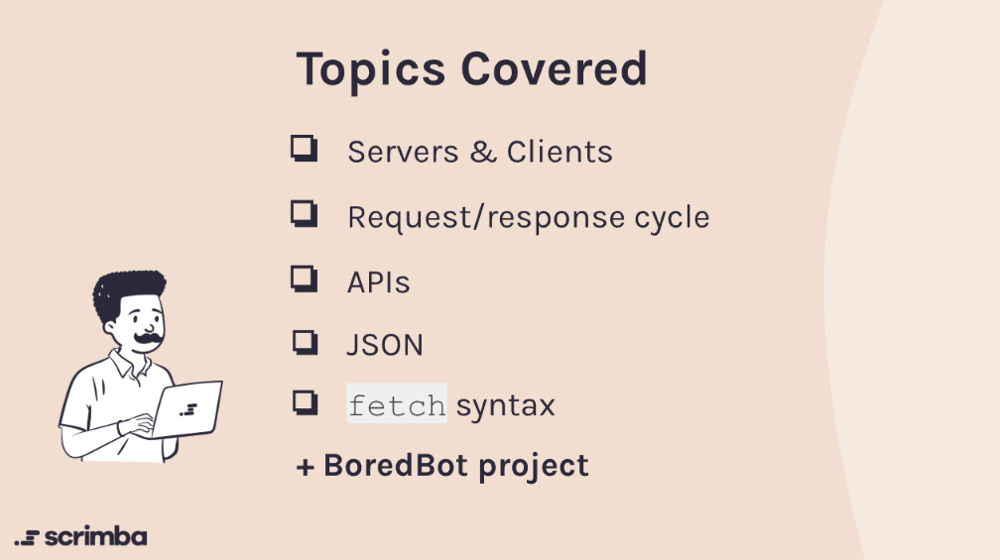

</details>

---

## 📡 Chapter 15: HTTP Requests

### Core Concept

**HTTP (Hypertext Transfer Protocol)** is the foundational communication protocol of the World Wide Web. It determines an agreed-upon, standard format for transferring hypertext, documents, media, and structured data between **clients** (such as browsers and mobile devices) and **servers**.

- **The Request / Response Cycle:**
  - **Request:** Sent when a client initiates a request asking for a specific resource or action from a server.
  - **Response:** Sent when a server returns a response (indicating success or failure) back to the client with appropriate headers, status codes, and body payload.
- **What is a Protocol?** A protocol is simply an agreed-upon, standardized convention for performing an action so different systems can communicate reliably. In the URL `https://apis.scrimba.com/jsonplaceholder/posts`, the `https` portion declares the protocol used.
- **Key Components of an HTTP Request:**
  1. **Path (URL / Endpoint):** The address targeting the exact resource on the network.
  2. **Method (HTTP Verb):** The action to be taken on the server:
     - `GET`: Retrieve existing data or resources (the default method used by `fetch()`).
     - `POST`: Send new data to the server to create a new resource.
     - `PUT`: Replace or update an entire existing resource.
     - `DELETE`: Remove a specified resource from the server.
     - *Others:* `PATCH` (apply partial modifications), `OPTIONS` (check server communication capabilities), etc.
  3. **Body:** The payload data included in the request (commonly serialized as JSON in `POST` or `PUT` calls).
  4. **Headers:** Key-value metadata passed along with the request providing context (e.g., `Content-Type: application/json`, auth tokens, accepted encodings).

### 💡 Visualizations

<details>
  <summary><b>📷 Expand to View HTTP Requests & Protocol Diagrams</b></summary>
  <br>

### 1. Request / Response Cycle

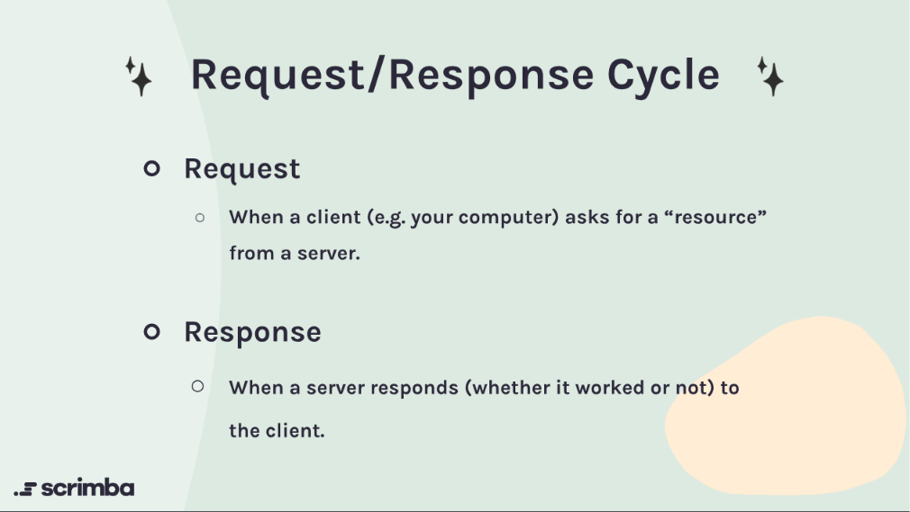

### 2. What is a Protocol & HTTP?

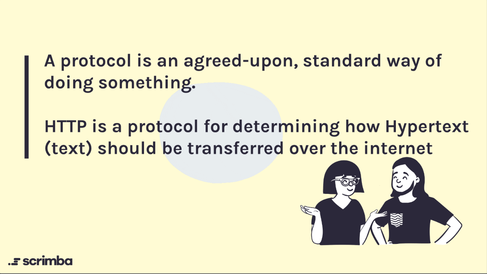

### 3. Components of a Request

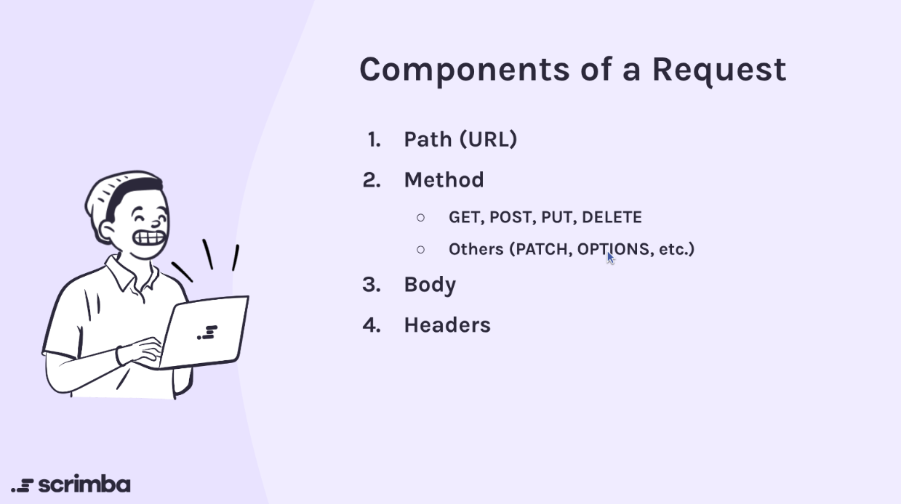

</details>

### 📝 Quiz & Recap

_(Original file: [quiz.md](<file:///c:/Users/suyas/Downloads/CODING%281%29/NEXTGEN-CODE/05-07-2026/APIs%20and%20Async%20JavaScript/URLs%20and%20REST/HTTP%20Requests/quiz.md>))_

> [!NOTE]
> **What does HTTP stand for?**
>
> - **Answer:** **Hypertext Transfer Protocol**

> [!TIP]
> **How would you describe what a protocol is to a complete newbie?**
>
> - **Answer:** An agreed-upon, standard way of doing something.

> [!IMPORTANT]
> **Which part of this URL describes the protocol?**
> `https://apis.scrimba.com/jsonplaceholder/posts`
>
> - **Answer:** `https` (Hypertext Transfer Protocol Secure).

> [!NOTE]
> **Which request method (GET, POST, PUT, DELETE) is used when requesting data from the JSON Placeholder API?**
>
> - **Answer:** **GET** — by default, `fetch()` issues a `GET` request when retrieving resources from an API endpoint.

### 💻 Code Implementation

You can explore the source files for this practice below:

- [index.html](<file:///c:/Users/suyas/Downloads/CODING%281%29/NEXTGEN-CODE/05-07-2026/APIs%20and%20Async%20JavaScript/URLs%20and%20REST/HTTP%20Requests/index.html>) - Structural markup loading the script.
- [index.js](<file:///c:/Users/suyas/Downloads/CODING%281%29/NEXTGEN-CODE/05-07-2026/APIs%20and%20Async%20JavaScript/URLs%20and%20REST/HTTP%20Requests/index.js>) - JavaScript logic initiating a fetch request to the JSONPlaceholder API.
- [index.css](<file:///c:/Users/suyas/Downloads/CODING%281%29/NEXTGEN-CODE/05-07-2026/APIs%20and%20Async%20JavaScript/URLs%20and%20REST/HTTP%20Requests/index.css>) - Background styling for the preview container.
- [quiz.md](<file:///c:/Users/suyas/Downloads/CODING%281%29/NEXTGEN-CODE/05-07-2026/APIs%20and%20Async%20JavaScript/URLs%20and%20REST/HTTP%20Requests/quiz.md>) - Knowledge check on protocols and HTTP methods.

```javascript
// Sending a GET request to JSON Placeholder API
fetch("https://apis.scrimba.com/jsonplaceholder/posts")
  .then((response) => response.json())
  .then((data) => console.log(data));
```

### 🔗 Chapter 15 Resources

- 📄 **JSONPlaceholder Documentation:** [JSONPlaceholder Guide](https://jsonplaceholder.typicode.com/) — Free fake online REST API for testing and prototyping.
- 📄 **MDN Web Docs:** [An Overview of HTTP](https://developer.mozilla.org/en-US/docs/Web/HTTP/Overview) — Core concepts, messages, and architecture of HTTP.
- 📄 **MDN Web Docs:** [HTTP Request Methods](https://developer.mozilla.org/en-US/docs/Web/HTTP/Methods) — Complete reference for GET, POST, PUT, DELETE, and more.
- 📄 **API Endpoint:** [JSONPlaceholder Posts (Scrimba Proxy)](https://apis.scrimba.com/jsonplaceholder/posts)

---

## 🎯 Chapter 16: Requests — URLs and Endpoints

### Core Concept

When making API requests, properly structuring the target address is essential for retrieving or manipulating the correct resources. Every web request targets an address made up of a **Base URL** and a specific **Endpoint**.

- **Base URL vs. Endpoint:**
  - **Base URL:** The fixed root address of the API service that remains constant across different calls (e.g., `https://apis.scrimba.com/jsonplaceholder` or `https://blahblahblah.com/api/v2`).
  - **Endpoint:** The dynamic path suffix that points to the specific resource, entity, or collection you want to access (e.g., `/posts`, `/users`, `/products`, or `/products/123`).
  - **Full Request URL:** Combining the Base URL and the Endpoint forms the complete destination address:

    $$
    \text{Full URL} = \text{Base URL} + \text{Endpoint}
    $$

    *Example:* `https://apis.scrimba.com/jsonplaceholder` + `/posts` $\rightarrow$ `https://apis.scrimba.com/jsonplaceholder/posts`
- **Inspecting JSON in the Browser:**
  - Pasting an API endpoint URL directly into your browser triggers a `GET` request, and the server returns raw JSON text.
  - Browser extensions like **JSON Formatter** make inspecting this response effortless by formatting the raw text into a color-coded, collapsible tree structure.

### 💡 Visualizations

<details>
  <summary><b>📷 Expand to View URLs & Endpoints Diagrams</b></summary>
  <br>

### 1. Path (URL): Base URL vs. Endpoint

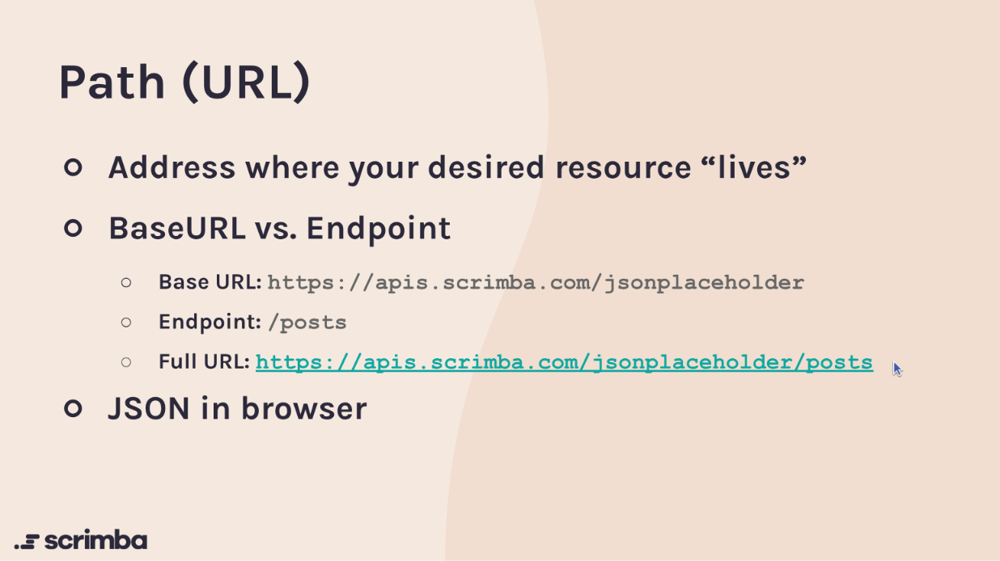

### 2. Inspecting JSON in the Browser

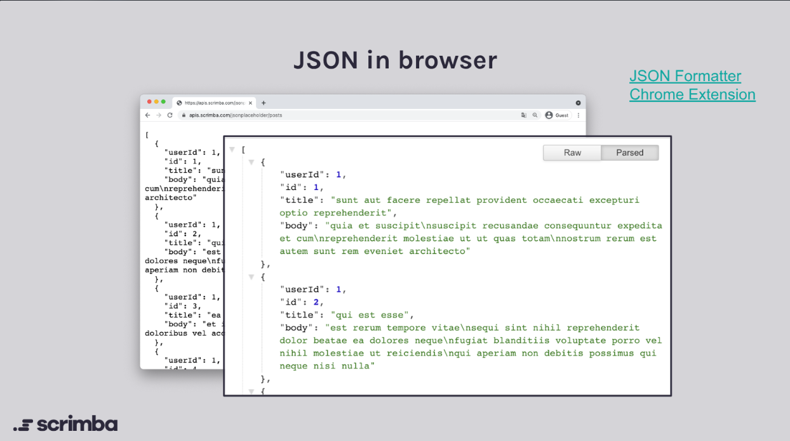

</details>

### 📝 Quiz & Recap

_(Original file: [quiz.md](<file:///c:/Users/suyas/Downloads/CODING%281%29/NEXTGEN-CODE/05-07-2026/APIs%20and%20Async%20JavaScript/URLs%20and%20REST/Requests%20-%20URLs%20and%20Endpoints/quiz.md>))_

> [!NOTE]
> **What is the difference between a Base URL and an Endpoint?**
>
> - **Base URL:** The part of the URL that won't change, no matter which resource we want to get from the API.
> - **Endpoint:** Specifies exactly which resource we want to get from the API.

> [!TIP]
> **Given the following example URLs:**
>
> - `https://blahblahblah.com/api/v2/users`
> - `https://blahblahblah.com/api/v2/products`
> - `https://blahblahblah.com/api/v2/products/123`
>
> **Which part is the Base URL?**
>
> - **Answer:** `https://blahblahblah.com/api/v2`

> [!IMPORTANT]
> **From the example URLs above, what are the available endpoints?**
>
> - **Answer:** `/users`, `/products`, `/products/<some-id-of-a-product-here>` (e.g., `/products/123`).

### 💻 Code Implementation

You can explore the source files for this practice below:

- [quiz.md](<file:///c:/Users/suyas/Downloads/CODING%281%29/NEXTGEN-CODE/05-07-2026/APIs%20and%20Async%20JavaScript/URLs%20and%20REST/Requests%20-%20URLs%20and%20Endpoints/quiz.md>) - Knowledge check on Base URLs and Endpoints.
- [README.md](<file:///c:/Users/suyas/Downloads/CODING%281%29/NEXTGEN-CODE/05-07-2026/APIs%20and%20Async%20JavaScript/URLs%20and%20REST/Requests%20-%20URLs%20and%20Endpoints/README.md>) - Setup guide and documentation.
- [package.json](<file:///c:/Users/suyas/Downloads/CODING%281%29/NEXTGEN-CODE/05-07-2026/APIs%20and%20Async%20JavaScript/URLs%20and%20REST/Requests%20-%20URLs%20and%20Endpoints/package.json>) - Project scripts and configuration.

```javascript
// Base URL and Endpoint separation pattern
const baseURL = "https://apis.scrimba.com/jsonplaceholder";
const endpoint = "/posts";

// Resulting request URL: https://apis.scrimba.com/jsonplaceholder/posts
fetch(`${baseURL}${endpoint}`)
  .then((response) => response.json())
  .then((data) => console.log(data));
```

### 🔗 Chapter 16 Resources

- 🧩 **Chrome Extension:** [JSON Formatter](https://chromewebstore.google.com/detail/json-formatter/bcjindcccaagfpapjjmafapmmgkkhgoa) — Popular browser extension to format and explore JSON responses directly in Google Chrome.
- 📄 **MDN Web Docs:** [What is a URL?](https://developer.mozilla.org/en-US/docs/Learn/Common_questions/Web_mechanics/What_is_a_URL) — Understanding URL syntax, hosts, and paths.
- 📄 **JSONPlaceholder:** [Available Endpoints Guide](https://jsonplaceholder.typicode.com/) — Reference for `/posts`, `/comments`, `/albums`, `/photos`, `/todos`, and `/users`.

---

## 📤 Chapter 17: Requests — Methods

### Core Concept

HTTP methods (also referred to as **HTTP Verbs**) indicate the specific action that the client wants to perform on a given resource. Understanding and utilizing the correct method is fundamental to RESTful API design.

- **The Primary HTTP Methods:**
  - **`GET` (Retrieve Data):** Used to request and retrieve data from a server without causing any side effects or changing server state (safe and idempotent). This is the default method executed when calling `fetch()` without additional options.
  - **`POST` (Add New Data):** Used to submit data to the server to create a new resource (e.g., submitting form data, uploading a file, publishing a new post).
  - **`PUT` (Update Existing Data):** Used to update or replace an existing resource completely on the server (e.g., modifying profile details, updating an item status).
  - **`DELETE` (Remove Data):** Used to remove or delete an existing resource from the server.
  - **Other Methods:** `PATCH` (applying partial modifications to a resource), `OPTIONS` (describing communication options for the target resource).
- **Explicit Method Configuration in `fetch()`:**
  - While `fetch(url)` performs a `GET` request by default, the method can be explicitly defined by passing an options configuration object as the second parameter:
    ```javascript
    fetch(url, { method: "GET" })
    ```

### 💡 Visualizations

<details>
  <summary><b>📷 Expand to View HTTP Request Methods Diagram</b></summary>
  <br>

### 1. HTTP Methods Overview

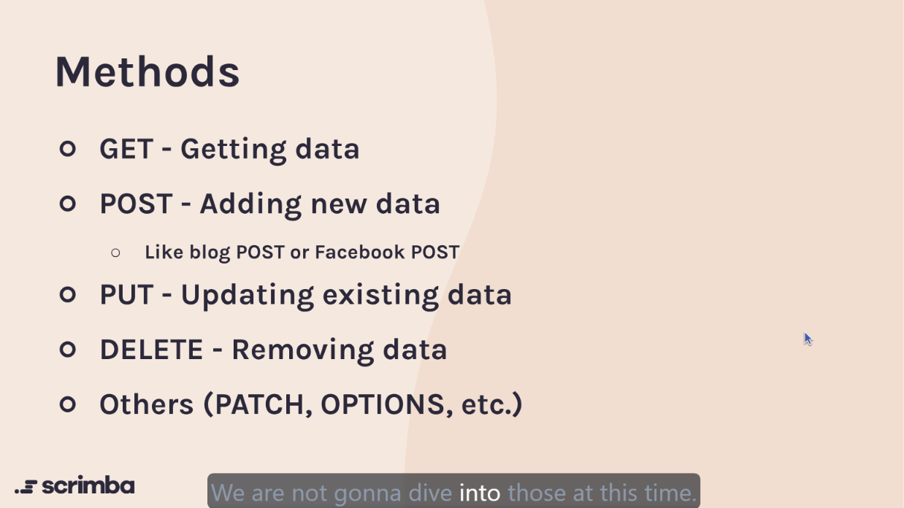

</details>

### 📝 Quiz & Recap

_(Original file: [quiz.md](<file:///c:/Users/suyas/Downloads/CODING%281%29/NEXTGEN-CODE/05-07-2026/APIs%20and%20Async%20JavaScript/URLs%20and%20REST/Requests%20-%20Methods/quiz.md>))_

> [!NOTE]
> **Real-world scenarios for each of the four main HTTP methods:**
>
> - **`GET` (Retrieve):** Checking the current weather forecast on your phone.
> - **`POST` (Create):** Creating and uploading a new screencast video or submitting a registration form.
> - **`PUT` (Update):** Marking tasks on a shared todo list as "completed".
> - **`DELETE` (Remove):** Deleting an accidental or obsolete chat message on Slack or Discord.

### 💻 Code Implementation

You can explore the source files for this practice below:

- [index.html](<file:///c:/Users/suyas/Downloads/CODING%281%29/NEXTGEN-CODE/05-07-2026/APIs%20and%20Async%20JavaScript/URLs%20and%20REST/Requests%20-%20Methods/index.html>) - Simple HTML wrapper.
- [index.js](<file:///c:/Users/suyas/Downloads/CODING%281%29/NEXTGEN-CODE/05-07-2026/APIs%20and%20Async%20JavaScript/URLs%20and%20REST/Requests%20-%20Methods/index.js>) - Explicitly setting `{ method: "GET" }` in the fetch options object.
- [quiz.md](<file:///c:/Users/suyas/Downloads/CODING%281%29/NEXTGEN-CODE/05-07-2026/APIs%20and%20Async%20JavaScript/URLs%20and%20REST/Requests%20-%20Methods/quiz.md>) - Knowledge check on HTTP method real-world usage.

```javascript
// Explicitly setting the request method to GET in fetch
fetch("https://apis.scrimba.com/jsonplaceholder/todos", {
  method: "GET",
})
  .then((res) => res.json())
  .then((data) => console.log(data));
```

### 🔗 Chapter 17 Resources

- 📄 **MDN Web Docs:** [HTTP Request Methods](https://developer.mozilla.org/en-US/docs/Web/HTTP/Methods) — In-depth guide to HTTP request verbs, safety, and idempotence.
- 📄 **MDN Web Docs:** [Fetch API Options &amp; Init](https://developer.mozilla.org/en-US/docs/Web/API/fetch#options) — Complete specification of `fetch()` parameters and request headers.
- 📄 **API Endpoint:** [JSONPlaceholder Todos Endpoint (Scrimba Proxy)](https://apis.scrimba.com/jsonplaceholder/todos)

---

## 📝 Chapter 18: BlogSpace — GET First 5 Blog Posts

### Core Concept

In this chapter, we kick off the **BlogSpace** project — an interactive blogging web application that communicates with a REST API to fetch, create, and manage blog posts.

- **Client-Side Data Truncation (`.slice()`):**
  - Often, API endpoints like `/posts` return large collections (e.g., 100 post objects).
  - To prevent performance bottlenecks or overwhelming the user interface, we can extract a specific subset using JavaScript's native array method: `data.slice(0, 5)`.
  - `.slice(start, end)` returns a shallow copy of a portion of the array from index `start` up to (but not including) index `end`.
- **Inspecting Blog Post Schema:**
  - Each item returned by the JSONPlaceholder `/posts` endpoint adheres to a standardized schema:
    - `userId` (number): ID of the user author.
    - `id` (number): Unique identifier for the specific post.
    - `title` (string): Title headline of the article.
    - `body` (string): Main textual body content.

### 📝 Key Takeaway

> [!TIP]
> **Why use `.slice(0, 5)` on API results?**
>
> When APIs do not support URL query parameters for server-side pagination (such as `?_limit=5`), using `data.slice(0, 5)` allows the frontend client to extract only the needed initial records, keeping state management clean and DOM rendering performant.

### 💻 Code Implementation

You can explore the source files for this practice below:

- [index.html](<file:///c:/Users/suyas/Downloads/CODING%281%29/NEXTGEN-CODE/05-07-2026/APIs%20and%20Async%20JavaScript/URLs%20and%20REST/BlogSpace%20-%20GET%20first%205%20blog%20posts/index.html>) - Baseline HTML template linking the script.
- [index.js](<file:///c:/Users/suyas/Downloads/CODING%281%29/NEXTGEN-CODE/05-07-2026/APIs%20and%20Async%20JavaScript/URLs%20and%20REST/BlogSpace%20-%20GET%20first%205%20blog%20posts/index.js>) - Logic initiating a GET request and truncating the results array to 5 items.
- [package.json](<file:///c:/Users/suyas/Downloads/CODING%281%29/NEXTGEN-CODE/05-07-2026/APIs%20and%20Async%20JavaScript/URLs%20and%20REST/BlogSpace%20-%20GET%20first%205%20blog%20posts/package.json>) - Project metadata and dev server configuration.

```javascript
// GET a list of blog posts and limit to the first 5 entries
fetch("https://apis.scrimba.com/jsonplaceholder/posts")
  .then((res) => res.json())
  .then((data) => {
    const postsArr = data.slice(0, 5);
    console.log(postsArr);
  });
```

### 🔗 Chapter 18 Resources

- 📄 **MDN Web Docs:** [Array.prototype.slice()](https://developer.mozilla.org/en-US/docs/Web/JavaScript/Reference/Global_Objects/Array/slice) — Syntax, parameters, and examples for extracting array segments.
- 📄 **API Endpoint:** [JSONPlaceholder Posts Endpoint (Scrimba Proxy)](https://apis.scrimba.com/jsonplaceholder/posts) — Mock REST endpoint serving blog post records.
- 📄 **JSONPlaceholder:** [Posts Resource Guide](https://jsonplaceholder.typicode.com/) — Reference for blog post object schema and relations.

---

## 🖥️ Chapter 19: BlogSpace — Display Blogs on Page

### Core Concept

In this chapter, we bridge the gap between network requests and visual rendering by dynamically generating and injecting HTML markup for the fetched blog posts directly into the browser DOM.

- **Dynamic DOM Rendering Pipeline:**
  1. **Fetch & Slice:** Query the `/posts` endpoint and limit the payload to the top 5 articles with `data.slice(0, 5)`.
  2. **String Accumulator Pattern:** Initialize an empty string (`let html = ""`) and iterate through the post objects using a `for...of` loop.
  3. **Template Literal Interpolation:** Construct HTML markup using ES6 template literals inserting `${post.title}` and `${post.body}` inside designated semantic tags (`<h3>`, `<p>`, `<hr />`).
  4. **Single-Pass DOM Injection:** Assign the accumulated string to `document.getElementById("blog-list").innerHTML = html` in one single operation.
- **Performance Optimization:**
  - Manipulating the DOM triggers browser layout recalculations and repaints. Modifying `.innerHTML` inside the loop causes 5 separate layout reflows. Accumulating the string first and performing a single write at the end ensures maximum rendering performance.

### 📝 Key Takeaway

> [!TIP]
> **Batch DOM Updates for High Performance:**
> Never mutate `.innerHTML` inside a loop (`element.innerHTML += ...`). Always accumulate the full HTML string in a local JavaScript variable first, then perform a single assignment to `.innerHTML` once the loop completes to minimize expensive DOM reflows.

### 💻 Code Implementation

You can explore the source files for this practice below:

- [index.html](<file:///c:/Users/suyas/Downloads/CODING%281%29/NEXTGEN-CODE/05-07-2026/APIs%20and%20Async%20JavaScript/URLs%20and%20REST/BlogSpace%20-%20Display%20blogs%20on%20page/index.html>) - Markup providing the `#blog-list` container div.
- [index.js](<file:///c:/Users/suyas/Downloads/CODING%281%29/NEXTGEN-CODE/05-07-2026/APIs%20and%20Async%20JavaScript/URLs%20and%20REST/BlogSpace%20-%20Display%20blogs%20on%20page/index.js>) - Logic iterating over sliced posts and injecting compiled HTML into the page.
- [package.json](<file:///c:/Users/suyas/Downloads/CODING%281%29/NEXTGEN-CODE/05-07-2026/APIs%20and%20Async%20JavaScript/URLs%20and%20REST/BlogSpace%20-%20Display%20blogs%20on%20page/package.json>) - Project scripts and configuration.

```javascript
// Fetch, accumulate HTML markup, and batch render into the DOM
fetch("https://apis.scrimba.com/jsonplaceholder/posts")
  .then((res) => res.json())
  .then((data) => {
    const postsArr = data.slice(0, 5);
    let html = "";
    for (let post of postsArr) {
      html += `
        <h3>${post.title}</h3>
        <p>${post.body}</p>
        <hr />
      `;
    }
    document.getElementById("blog-list").innerHTML = html;
  });
```

### 🔗 Chapter 19 Resources

- 📄 **MDN Web Docs:** [Template Literals](https://developer.mozilla.org/en-US/docs/Web/JavaScript/Reference/Template_literals) — Syntax, multiline strings, and expression interpolation.
- 📄 **MDN Web Docs:** [Element.innerHTML](https://developer.mozilla.org/en-US/docs/Web/API/Element/innerHTML) — Best practices, security considerations, and usage of `innerHTML`.
- 📄 **API Endpoint:** [JSONPlaceholder Posts Endpoint (Scrimba Proxy)](https://apis.scrimba.com/jsonplaceholder/posts)

---

## 🎨 Chapter 20: BlogSpace — Add Styling

### Core Concept

In this chapter, we elevate the visual presentation of **BlogSpace** by introducing modern typography, flex-based alignment, and fixed layout positioning.

- **Fixed Navigation Bar (`position: fixed`):**
  - Pinning a navigation bar `<nav>` to the top of the browser screen (`position: fixed`, `width: 100%`, `height: 30px`).
  - Leveraging `display: flex` and `align-items: center` to ensure the logo/brand header stays vertically centered across all screen resolutions.
- **Handling Fixed Element Document Flow (Top Offset):**
  - Because `position: fixed` elements are removed from normal document flow, subsequent siblings render at `top: 0` underneath the header.
  - Adding a compensatory top padding on `#blog-list` (`padding: 30px 10px 10px`) creates the necessary offset so article cards remain fully visible below the navbar.
- **Custom Google Fonts Typography:**
  - Importing the **Karla** typeface from Google Fonts via CDN `<link>` tags.
  - Setting a global font family (`font-family: 'Karla', sans-serif`) with zeroed margins for a clean, modern aesthetic.

### 📝 Key Takeaway

> [!TIP]
> **Preventing Content Overlap with Fixed Navbars:**
> Whenever using `position: fixed` on a header or navigation bar, remember that it occupies zero flow height in the DOM. Always add an equivalent `padding-top` or `margin-top` to the subsequent main content container to prevent elements from being hidden behind the header.

### 💻 Code Implementation

You can explore the source files for this practice below:

- [index.html](<file:///c:/Users/suyas/Downloads/CODING%281%29/NEXTGEN-CODE/05-07-2026/APIs%20and%20Async%20JavaScript/URLs%20and%20REST/BlogSpace%20-%20Add%20styling/index.html>) - Markup introducing the fixed `<nav>` bar and Google Fonts links.
- [index.css](<file:///c:/Users/suyas/Downloads/CODING%281%29/NEXTGEN-CODE/05-07-2026/APIs%20and%20Async%20JavaScript/URLs%20and%20REST/BlogSpace%20-%20Add%20styling/index.css>) - CSS rules for typography, flex alignment, and offset padding.
- [index.js](<file:///c:/Users/suyas/Downloads/CODING%281%29/NEXTGEN-CODE/05-07-2026/APIs%20and%20Async%20JavaScript/URLs%20and%20REST/BlogSpace%20-%20Add%20styling/index.js>) - JavaScript logic rendering the styled blog posts.

```css
/* Fixed navbar and offset container styles */
nav {
  background-color: beige;
  padding: 5px;
  height: 30px;
  display: flex;
  align-items: center;
  position: fixed;
  width: 100%;
}

nav > h3 {
  margin: 0;
}

#blog-list {
  padding: 30px 10px 10px; /* Offset to clear the fixed navbar */
}
```

### 🔗 Chapter 20 Resources

- 📄 **Google Fonts:** [Karla Typography](https://fonts.google.com/specimen/Karla) — Modern grotesque sans-serif font family.
- 📄 **MDN Web Docs:** [CSS Positioning - Fixed](https://developer.mozilla.org/en-US/docs/Web/CSS/position#fixed) — Mechanics of viewport-relative positioning.
- 📄 **MDN Web Docs:** [CSS Flexbox Layout](https://developer.mozilla.org/en-US/docs/Web/CSS/CSS_flexible_box_layout/Basic_concepts_of_flexbox) — Alignment and distribution within the navigation bar.

---

## 📝 Chapter 21: BlogSpace — New Post Form

### Core Concept

In this chapter, we extend **BlogSpace** by constructing an interactive submission form for creating new blog posts. This forms the frontend foundation necessary to capture user input and dispatch data to our REST API using the HTTP `POST` method.

- **Semantic HTML Form Structure:**
  - Wrapping controls within a `<form>` container to group related data-entry elements.
  - Linking `<label>` elements to input controls via the `for` attribute matching the input's `id` attribute (`for="post-title"` -> `id="post-title"`, `for="post-body"` -> `id="post-body"`). This guarantees proper accessibility for assistive technologies and allows clicking the label to focus the control.
- **Appropriate Form Controls:**
  - `<input type="text">`: Optimal for single-line text data such as article titles.
  - `<textarea>`: Tailored for multiline text data such as the article body.
  - `<button>`: Inside a `<form>`, any button defaults to `type="submit"`, enabling submission triggers.
- **Layout and Spacing with Fixed Navigation:**
  - With the fixed navbar positioned at the top (`position: fixed`), page elements require a top offset to remain visible.
  - The padding offset is transferred from `#blog-list` directly to `form` (`padding: 60px 10px 10px;`), positioning the inputs cleanly below the navbar while letting `#blog-list` sit naturally underneath with `padding: 10px;`.

### 💡 Visualizations & Architecture

<details>
  <summary><b>📷 Expand to View Form Structure & Flow Diagram</b></summary>
  <br>

```mermaid
flowchart TD
    subgraph Viewport ["Browser Viewport"]
        Nav["Fixed Navbar: <nav> (position: fixed)"]
        subgraph FormBlock ["Submission Form: <form> (padding: 60px 10px 10px)"]
            TitleGroup["Title Field: <label for='post-title'> + <input id='post-title'>"]
            BodyGroup["Body Field: <label for='post-body'> + <textarea id='post-body'>"]
            SubmitAction["Action Button: <button>Post</button>"]
        end
        BlogContainer["Blog Articles Feed: <div id='blog-list'>"]
    end

    Nav -. Offset Clearance .-> FormBlock
    TitleGroup --> SubmitAction
    BodyGroup --> SubmitAction
    SubmitAction -. Prepares POST Request .-> BlogContainer
```

</details>

### 📝 Quiz & Recap

> [!NOTE]
> **Why is explicitly pairing `<label for="...">` with `<input id="...">` crucial for web development?**
>
> - **Answer:** It binds the label to the input programmatically. This allows screen readers to announce the label when the field receives focus, and improves user experience by focusing or activating the input when the label is clicked.

> [!TIP]
> **When should you choose `<textarea>` instead of `<input type="text">`?**
>
> - **Answer:** Use `<input type="text">` for short, single-line text inputs (like names, headlines, or emails). Use `<textarea>` whenever users need to type multi-line paragraphs or expandable content (like message bodies, comments, or blog posts).

> [!IMPORTANT]
> **What is the default behavior of a `<button>` located inside a `<form>`?**
>
> - **Answer:** Unless an explicit `type="button"` attribute is provided, any button placed inside a form defaults to `type="submit"`. When clicked, it attempts to submit the form and triggers a browser page reload unless intercepted in JavaScript using `event.preventDefault()`.

### 💻 Code Implementation

You can explore the source files for this practice below:

- [index.html](<file:///c:/Users/suyas/Downloads/CODING%281%29/NEXTGEN-CODE/05-07-2026/APIs%20and%20Async%20JavaScript/URLs%20and%20REST/BlogSpace%20-%20New%20post%20form/index.html>) - Semantic form markup containing labels, single-line text input, textarea, and submission button.
- [index.css](<file:///c:/Users/suyas/Downloads/CODING%281%29/NEXTGEN-CODE/05-07-2026/APIs%20and%20Async%20JavaScript/URLs%20and%20REST/BlogSpace%20-%20New%20post%20form/index.css>) - Styles providing padding offset for the form beneath the fixed navbar.
- [index.js](<file:///c:/Users/suyas/Downloads/CODING%281%29/NEXTGEN-CODE/05-07-2026/APIs%20and%20Async%20JavaScript/URLs%20and%20REST/BlogSpace%20-%20New%20post%20form/index.js>) - Script fetching and rendering the initial 5 blog posts into `#blog-list`.
- [package.json](<file:///c:/Users/suyas/Downloads/CODING%281%29/NEXTGEN-CODE/05-07-2026/APIs%20and%20Async%20JavaScript/URLs%20and%20REST/BlogSpace%20-%20New%20post%20form/package.json>) - Project metadata and dev server configuration.

```html
<!-- HTML Form for creating a new blog post -->
<form>
    <label for="post-title">Title:</label>
    <input id="post-title" type="text" />
    <label for="post-body">Body:</label>
    <textarea id="post-body"></textarea>
    <button>Post</button>
</form>
```

```css
/* Layout offset adjustment to clear fixed navbar */
form {
    padding: 60px 10px 10px;
}

#blog-list {
    padding: 10px;
}
```

### 🔗 Chapter 21 Resources

- 📄 **MDN Web Docs:** [Your First HTML Form](https://developer.mozilla.org/en-US/docs/Learn/Forms/Your_first_form) — Guide to creating accessible, functional HTML forms.
- 📄 **MDN Web Docs:** [The `<label>` element](https://developer.mozilla.org/en-US/docs/Web/HTML/Element/label) — Proper usage of labels, the `for` attribute, and accessibility benefits.
- 📄 **MDN Web Docs:** [The `<textarea>` element](https://developer.mozilla.org/en-US/docs/Web/HTML/Element/textarea) — Multiline plain-text editing control.
- 📄 **MDN Web Docs:** [The `<button>` element](https://developer.mozilla.org/en-US/docs/Web/HTML/Element/button) — Types, defaults, and form interaction behaviors.

---

## 🎨 Chapter 22: BlogSpace — Add Style to Form

### Core Concept

In this chapter, we transform the raw HTML form from the previous lesson into an intuitive, visually polished interface using **CSS Flexbox**.

- **Vertical Flex Flow (`display: flex; flex-direction: column;`):**
  - Stacks each form element (labels, single-line text input, textarea, and submit button) vertically in an orderly, natural sequence.
  - Eliminates clunky inline wrapping behaviors and ensures labels stay cleanly positioned above their inputs.
- **Section Contrast & Background Separation:**
  - Introducing a dedicated background color (`background-color: #f1ede9`) gives the form visual weight and provides clear separation between creation tools and the article feed below.
- **Typography Inheritance (`font-family: inherit`):**
  - Browsers often reset form controls (`<input>`, `<textarea>`, `<button>`) to system default fonts. Explicitly declaring `font-family: inherit` ensures the **Karla** typeface is uniformly applied across all form controls.
- **Action Button Sizing (`align-self: flex-start`):**
  - By default, children in a column flexbox container stretch to 100% width.
  - Applying `align-self: flex-start` allows the `<button>` to size to its content while staying cleanly aligned with the left edge of the input fields.

### 💡 Visualizations & Architecture

<details>
  <summary><b>📷 Expand to View Form Styling & Layout Diagram</b></summary>
  <br>

```mermaid
flowchart TD
    subgraph FormWrapper ["Styled Form (<form>) — flex-direction: column"]
        Background["Background Tint (#f1ede9) + Top Offset Padding"]
        subgraph Fields ["Vertical Element Flow"]
            TitleLabel["<label for='post-title'> (font-weight: 700)"]
            TitleInput["<input id='post-title'> (padding: 6px, border-radius: 4px)"]
            BodyLabel["<label for='post-body'> (font-weight: 700)"]
            BodyTextarea["<textarea id='post-body'> (resize: vertical, min-height: 60px)"]
            ActionBtn["<button>Post</button> (align-self: flex-start, hover transition)"]
        end
    end

    Background --> Fields
    TitleLabel --> TitleInput --> BodyLabel --> BodyTextarea --> ActionBtn
```

</details>

### 📝 Quiz & Recap

> [!NOTE]
> **Why do `<input>` and `<textarea>` elements not always inherit the page font family automatically?**
>
> - **Answer:** Browsers apply user-agent default stylesheets to interactive form controls that override standard document font cascade. Declaring `font-family: inherit` explicitly forces inputs and textareas to inherit the parent font family (`Karla`).

> [!TIP]
> **How does `display: flex; flex-direction: column;` improve form design over default layout?**
>
> - **Answer:** It arranges form elements in a clean vertical stack without requiring `<br>` tags or complex wrapper divs, while providing centralized control over element spacing, stretching, and cross-axis alignment.

> [!IMPORTANT]
> **Why is `align-self: flex-start` helpful on a button inside a column flexbox container?**
>
> - **Answer:** In a column flex container, items default to `stretch` on the cross axis, which causes the submit button to span the full width of the container. `align-self: flex-start` overrides this, confining the button to its natural content width.

### 💻 Code Implementation

You can explore the source files for this practice below:

- [index.html](<file:///c:/Users/suyas/Downloads/CODING%281%29/NEXTGEN-CODE/05-07-2026/APIs%20and%20Async%20JavaScript/URLs%20and%20REST/BlogSpace%20-%20Add%20style%20to%20form/index.html>) - Baseline HTML template linking styled form elements.
- [index.css](<file:///c:/Users/suyas/Downloads/CODING%281%29/NEXTGEN-CODE/05-07-2026/APIs%20and%20Async%20JavaScript/URLs%20and%20REST/BlogSpace%20-%20Add%20style%20to%20form/index.css>) - CSS styling applying column flexbox layout, input padding, and button states.
- [index.js](<file:///c:/Users/suyas/Downloads/CODING%281%29/NEXTGEN-CODE/05-07-2026/APIs%20and%20Async%20JavaScript/URLs%20and%20REST/BlogSpace%20-%20Add%20style%20to%20form/index.js>) - Logic fetching initial posts and populating the feed.
- [package.json](<file:///c:/Users/suyas/Downloads/CODING%281%29/NEXTGEN-CODE/05-07-2026/APIs%20and%20Async%20JavaScript/URLs%20and%20REST/BlogSpace%20-%20Add%20style%20to%20form/package.json>) - Project configuration and Vite scripts.

```css
/* Vertical flexbox layout and styled form controls */
form {
    padding: 60px 10px 10px;
    background-color: #f1ede9;
    display: flex;
    flex-direction: column;
}

label {
    margin-bottom: 4px;
    font-weight: 700;
}

input, textarea {
    margin-bottom: 12px;
    padding: 6px 8px;
    font-family: inherit;
    border: 1px solid #ccc;
    border-radius: 4px;
    font-size: 14px;
}

textarea {
    resize: vertical;
    min-height: 60px;
}

button {
    align-self: flex-start;
    padding: 8px 16px;
    background-color: #2b283a;
    color: #ffffff;
    border: none;
    border-radius: 4px;
    font-family: inherit;
    font-weight: 700;
    cursor: pointer;
    transition: background-color 0.2s ease;
}

button:hover {
    background-color: #000000;
}
```

### 🔗 Chapter 22 Resources

- 📄 **MDN Web Docs:** [CSS Flexbox: flex-direction](https://developer.mozilla.org/en-US/docs/Web/CSS/flex-direction) — Establishing column versus row layout directions.
- 📄 **MDN Web Docs:** [CSS align-self](https://developer.mozilla.org/en-US/docs/Web/CSS/align-self) — Overriding default cross-axis alignment for individual flex items.
- 📄 **MDN Web Docs:** [Styling HTML Forms](https://developer.mozilla.org/en-US/docs/Learn/Forms/Styling_web_forms) — Best practices for cross-browser input styling and font inheritance.

---

## ⚡ Chapter 23: BlogSpace — Form Submit Event Listener

### Core Concept

In this chapter, we connect user interaction to client-side data handling by attaching an event listener to the submission form, suppressing native browser navigation, and capturing user input into a structured JavaScript payload object.

- **Attaching the `"submit"` Event Listener:**
  - Attaching the listener directly to the `<form>` container (`form.addEventListener("submit", ...)`) rather than to the submit button's `"click"` event.
  - This ensures our application responds consistently whether the user activates the button by clicking or by pressing <kbd>Enter</kbd> while typing in an input field.
- **Suppressing Default Page Reloads (`e.preventDefault()`):**
  - By default, standard HTML forms perform an HTTP submission and reload the page.
  - Invoking `event.preventDefault()` halts this behavior, allowing asynchronous JavaScript (AJAX / `fetch`) to process and deliver the data seamlessly without losing application state.
- **Extracting Values & Constructing the Payload Object:**
  - Querying input elements and retrieving their `.value` properties (`document.getElementById("post-title").value` and `document.getElementById("post-body").value`).
  - Packaging the values into a concise key-value object (`{ title, body }`) that matches the schema required by the REST API endpoint.

### 💡 Visualizations & Architecture

<details>
  <summary><b>📷 Expand to View Submit Event Handling Flow Diagram</b></summary>
  <br>

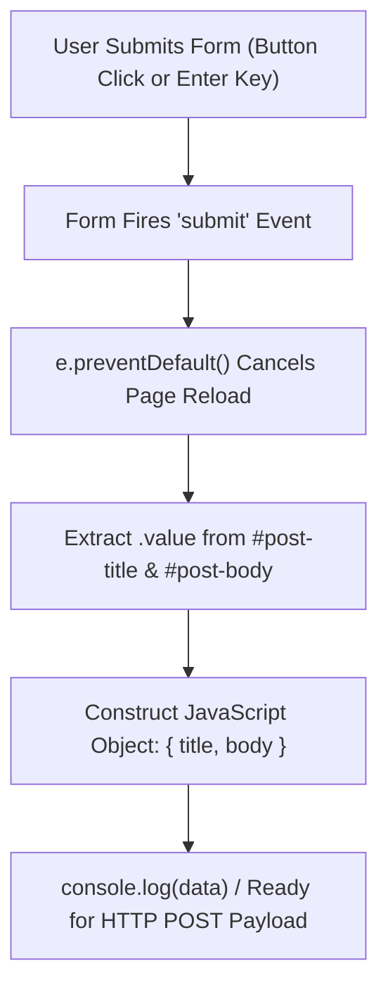

</details>

### 📝 Quiz & Recap

> [!NOTE]
> **Why is it best practice to listen for `"submit"` on the `<form>` instead of `"click"` on the `<button>`?**
>
> - **Answer:** The `"submit"` event fires regardless of how the form is submitted — whether by clicking the submit button, tapping on mobile, or pressing <kbd>Enter</kbd> inside a text input. Listening to `"click"` on the button misses keyboard submissions.

> [!TIP]
> **What critical role does `event.preventDefault()` play in Single-Page Applications (SPAs)?**
>
> - **Answer:** It prevents the browser from refreshing the page or attempting a synchronous full-page HTTP POST. This keeps the current DOM and application state intact so data can be processed asynchronously in the background.

> [!IMPORTANT]
> **How do you access text entered by a user into an `<input>` or `<textarea>`?**
>
> - **Answer:** Access the `.value` property of the DOM element (e.g., `inputElement.value`). Unlike static text containers that use `.textContent` or `.innerHTML`, form fields store user-typed data exclusively in `.value`.

### 💻 Code Implementation

You can explore the source files for this practice below:

- [index.html](<file:///c:/Users/suyas/Downloads/CODING%281%29/NEXTGEN-CODE/05-07-2026/APIs%20and%20Async%20JavaScript/URLs%20and%20REST/BlogSpace%20-%20Form%20submit%20event%20listener/index.html>) - HTML template containing the blog post form with inputs and submit button.
- [index.css](<file:///c:/Users/suyas/Downloads/CODING%281%29/NEXTGEN-CODE/05-07-2026/APIs%20and%20Async%20JavaScript/URLs%20and%20REST/BlogSpace%20-%20Form%20submit%20event%20listener/index.css>) - Styles defining grid layout, background color, and button appearance.
- [index.js](<file:///c:/Users/suyas/Downloads/CODING%281%29/NEXTGEN-CODE/05-07-2026/APIs%20and%20Async%20JavaScript/URLs%20and%20REST/BlogSpace%20-%20Form%20submit%20event%20listener/index.js>) - Form submit event listener preventing reload and logging the post payload.
- [package.json](<file:///c:/Users/suyas/Downloads/CODING%281%29/NEXTGEN-CODE/05-07-2026/APIs%20and%20Async%20JavaScript/URLs%20and%20REST/BlogSpace%20-%20Form%20submit%20event%20listener/package.json>) - Project configuration and dev dependencies.

```javascript
// Listen for form submit event, prevent refresh, and extract post payload
document.querySelector("form").addEventListener("submit", function(e) {
    e.preventDefault();
    const postTitle = document.getElementById("post-title").value;
    const postBody = document.getElementById("post-body").value;
    const data = {
        title: postTitle,
        body: postBody
    };
    console.log(data);
});
```

### 🔗 Chapter 23 Resources

- 📄 **MDN Web Docs:** [HTMLFormElement: submit event](https://developer.mozilla.org/en-US/docs/Web/API/HTMLFormElement/submit_event) — Event details, form submission triggers, and bubbling.
- 📄 **MDN Web Docs:** [Event: preventDefault() method](https://developer.mozilla.org/en-US/docs/Web/API/Event/preventDefault) — Halting default browser event actions.
- 📄 **MDN Web Docs:** [HTMLInputElement: value property](https://developer.mozilla.org/en-US/docs/Web/API/HTMLInputElement#value) — Reading live user-entered input values.

---

## 📦 Chapter 24: Requests — Body

### Core Concept

When sending data from the client to a server, the **Request Body** carries the actual data payload. Understanding how to structure, serialize, and deliver this payload is fundamental when communicating with REST APIs.

- **Purpose of the Request Body:**
  - The body contains the payload of information you want the server to receive, process, or store.
  - While `GET` requests retrieve data and typically do not carry a body, mutating HTTP methods such as `POST` (create), `PUT` (replace), and `PATCH` (partial update) rely on the request body to transfer information.
- **Serializing Payloads with `JSON.stringify()`:**
  - HTTP transmits raw strings or byte streams across the network, not live JavaScript runtime objects.
  - If a JavaScript object `{ title: "Buy Milk", completed: false }` is passed directly without serialization, JavaScript converts it to the literal string `"[object Object]"`, resulting in server errors or corrupted records.
  - Using `JSON.stringify(...)` converts the JavaScript object into a standardized, RFC-compliant JSON string that any server-side language can parse and deserialize.
- **Configuring the `fetch()` Options Object:**
  - The second argument to `fetch()` accepts a configuration options object containing the HTTP `method` and the stringified `body`:
    ```javascript
    fetch(url, {
        method: "POST",
        body: JSON.stringify(payload)
    })
    ```
- **Parsing the Server Response:**
  - After receiving the payload, the REST API returns a response confirming the creation of the record, often including a newly minted unique identifier (`id`).
  - Chaining `.then(res => res.json())` and `.then(data => console.log(data))` parses the server's JSON response and allows inspecting the confirmed record in the console.

### 💡 Visualizations & Architecture

<details>
  <summary><b>📷 Expand to View Request Body Visualizations & Flow Diagram</b></summary>
  <br>

### 1. Request Body Concept Slide

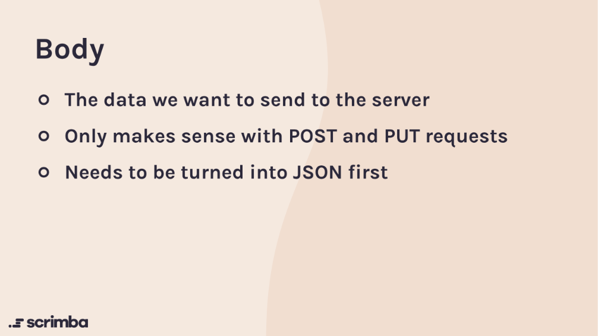

### 2. Request Body Transmission & Serialization Flow

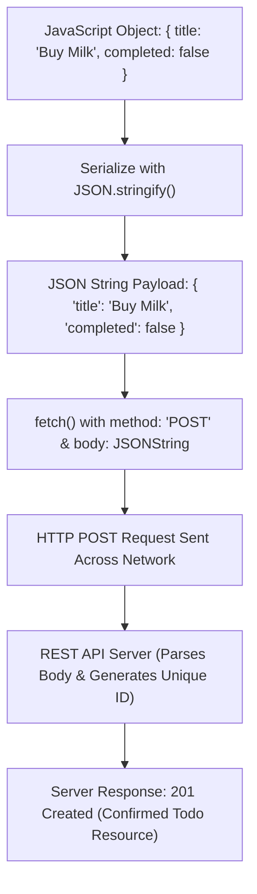

</details>

### 📝 Quiz & Recap

> [!NOTE]
> **What is the request `body` in HTTP, and when is it typically used?**
>
> - **Answer:** The `body` is the actual payload of data transmitted from the client to the server. It is primarily used with HTTP methods intended to send or mutate data, such as `POST` (create), `PUT` (replace), and `PATCH` (partial update). It is generally omitted in `GET` and `DELETE` requests.

> [!TIP]
> **Why must JavaScript objects be converted with `JSON.stringify()` before passing them into `body`?**
>
> - **Answer:** HTTP transmits data across networks as text strings or binary streams, not as live runtime JavaScript memory objects. If you pass a plain object directly without serializing it, JavaScript converts it to the string `"[object Object]"`, corrupting the data. `JSON.stringify()` converts the object into a standardized JSON string that the server can parse.

> [!IMPORTANT]
> **What does a REST API endpoint like JSONPlaceholder return when receiving a POST request?**
>
> - **Answer:** The server processes the transmitted JSON body, generates a new unique identifier (such as `id: 201`), and returns the created resource object back to the client in the response payload, confirming that the new item was accepted.

### 💻 Code Implementation

You can explore the source files for this practice below:

- [index.html](<file:///c:/Users/suyas/Downloads/CODING%281%29/NEXTGEN-CODE/05-07-2026/APIs%20and%20Async%20JavaScript/URLs%20and%20REST/Requests%20-%20Body/index.html>) - Baseline HTML template linking the script bundle.
- [index.js](<file:///c:/Users/suyas/Downloads/CODING%281%29/NEXTGEN-CODE/05-07-2026/APIs%20and%20Async%20JavaScript/URLs%20and%20REST/Requests%20-%20Body/index.js>) - Logic executing a POST request with a stringified JSON body and parsing the response.
- [package.json](<file:///c:/Users/suyas/Downloads/CODING%281%29/NEXTGEN-CODE/05-07-2026/APIs%20and%20Async%20JavaScript/URLs%20and%20REST/Requests%20-%20Body/package.json>) - Project metadata and Webpack build dependencies.
- [webpack.config.js](<file:///c:/Users/suyas/Downloads/CODING%281%29/NEXTGEN-CODE/05-07-2026/APIs%20and%20Async%20JavaScript/URLs%20and%20REST/Requests%20-%20Body/webpack.config.js>) - Module bundler configuration.

```javascript
// Send a POST request with a stringified JSON payload to add a new todo item
fetch("https://apis.scrimba.com/jsonplaceholder/todos", {
    method: "POST",
    body: JSON.stringify({
        title: "Buy Milk",
        completed: false
    })
})
    .then(res => res.json())
    .then(data => console.log(data));
```

### 🔗 Chapter 24 Resources

- 📄 **MDN Web Docs:** [Fetch API - Request: body](https://developer.mozilla.org/en-US/docs/Web/API/Request/body) — How request bodies are structured and transferred in `fetch()`.
- 📄 **MDN Web Docs:** [JSON.stringify()](https://developer.mozilla.org/en-US/docs/Web/JavaScript/Reference/Global_Objects/JSON/stringify) — Syntax, parameters, and serialization mechanics for converting objects to JSON.
- 📄 **MDN Web Docs:** [Using the Fetch API - Uploading JSON Data](https://developer.mozilla.org/en-US/docs/Web/API/Fetch_API/Using_Fetch#uploading_json_data) — Step-by-step guide to sending JSON payloads.
- 📄 **API Endpoint:** [JSONPlaceholder Todos Endpoint (Scrimba Proxy)](https://apis.scrimba.com/jsonplaceholder/todos) — Mock REST endpoint for todo records.

---

## 📋 Chapter 25: Requests — Headers

### Core Concept

When making HTTP requests, **Headers** provide critical metadata about the request itself. While the **body** contains the actual payload, headers inform the server about authentication tokens, client software details, and the formatting of the data being transmitted.

- **Role of HTTP Request Headers:**
  - Headers are key-value metadata pairs included in the request package (e.g., authorization, language preferences, user-agent, caching instructions).
  - One of the most important request headers in modern REST communication is **`Content-Type`**.
- **The `Content-Type` Header:**
  - When sending a payload with `POST` or `PUT`, the server must know what format the raw body text represents (e.g., JSON, URL-encoded form data, XML, or plain text).
  - By default, browsers may send `text/plain` or leave the content type ambiguous.
  - Setting `"Content-Type": "application/json"` explicitly informs the server's incoming body parser middleware (such as `express.json()`) that the payload is JSON-formatted and should be deserialized into a native object.
- **Configuring Headers in `fetch()`:**
  - Headers are declared as a nested object under the `headers` property within the second argument options object of `fetch()`:
    ```javascript
    fetch(url, {
        method: "POST",
        body: JSON.stringify(payload),
        headers: {
            "Content-Type": "application/json"
        }
    })
    ```
- **Bidirectional Header Communication:**
  - Headers exist in both directions: clients send **Request Headers** to clarify intent and content format, and servers return **Response Headers** specifying response content type, caching policies, and server timestamps.

### 💡 Visualizations & Architecture

<details>
  <summary><b>📷 Expand to View Request Headers Visualizations & Flow Diagram</b></summary>
  <br>

### 1. Request Headers Concept Slide

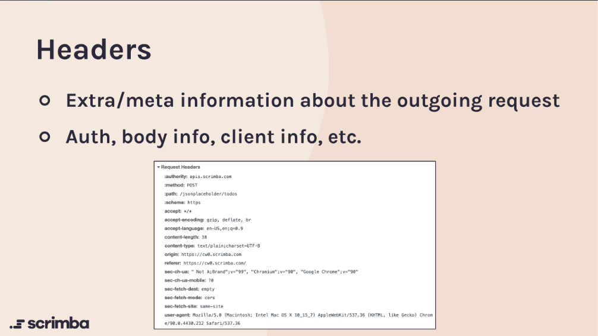

### 2. Header Content Negotiation Flow

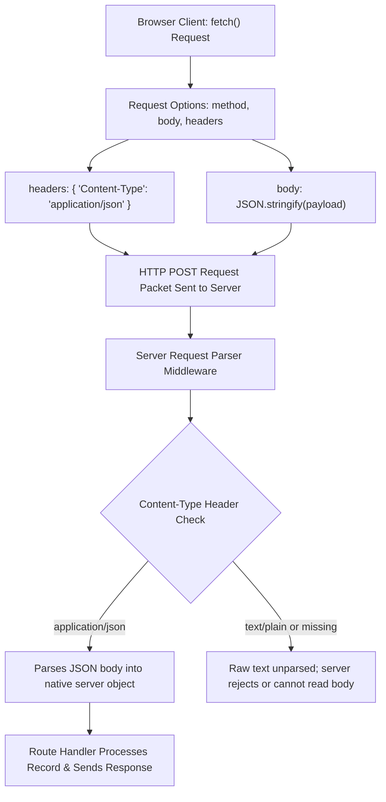

</details>

### 📝 Quiz & Recap

> [!NOTE]
> **What are HTTP headers and what purpose do they serve?**
>
> - **Answer:** Headers represent metadata sent alongside an HTTP request or response. They communicate essential contextual details such as data formatting (`Content-Type`), client authorization (`Authorization`), accepted response types (`Accept`), and client device information (`User-Agent`).

> [!TIP]
> **Why is `"Content-Type": "application/json"` required when sending serialized JSON payloads?**
>
> - **Answer:** Without this header, the server cannot know how to interpret the raw string of characters in the request body. Declaring `"Content-Type": "application/json"` instructs the server's body-parsing middleware to deserialize the text stream into a structured object rather than treating it as plain text.

> [!IMPORTANT]
> **Where do you specify headers within a `fetch()` call?**
>
> - **Answer:** Inside the configuration options object passed as the second argument to `fetch()`, under the `headers` key (e.g., `{ method: "POST", body: ..., headers: { "Content-Type": "application/json" } }`).

### 💻 Code Implementation

You can explore the source files for this practice below:

- [index.html](<file:///c:/Users/suyas/Downloads/CODING%281%29/NEXTGEN-CODE/05-07-2026/APIs%20and%20Async%20JavaScript/URLs%20and%20REST/Requests%20-%20Headers/index.html>) - Baseline HTML template linking the script bundle.
- [index.js](<file:///c:/Users/suyas/Downloads/CODING%281%29/NEXTGEN-CODE/05-07-2026/APIs%20and%20Async%20JavaScript/URLs%20and%20REST/Requests%20-%20Headers/index.js>) - Logic executing a POST request with stringified body and explicit Content-Type JSON header.
- [package.json](<file:///c:/Users/suyas/Downloads/CODING%281%29/NEXTGEN-CODE/05-07-2026/APIs%20and%20Async%20JavaScript/URLs%20and%20REST/Requests%20-%20Headers/package.json>) - Project metadata and build scripts.
- [webpack.config.js](<file:///c:/Users/suyas/Downloads/CODING%281%29/NEXTGEN-CODE/05-07-2026/APIs%20and%20Async%20JavaScript/URLs%20and%20REST/Requests%20-%20Headers/webpack.config.js>) - Module bundler configuration.

```javascript
// Send a POST request with a stringified body and explicit JSON Content-Type header
fetch("https://apis.scrimba.com/jsonplaceholder/todos", {
    method: "POST",
    body: JSON.stringify({
        title: "Buy Milk",
        completed: false
    }),
    headers: {
        "Content-Type": "application/json"
    }
})
    .then(res => res.json())
    .then(data => console.log(data));
```

### 🔗 Chapter 25 Resources

- 📄 **MDN Web Docs:** [HTTP Headers](https://developer.mozilla.org/en-US/docs/Web/HTTP/Headers) — Overview of request, response, representation, and payload headers.
- 📄 **MDN Web Docs:** [Content-Type](https://developer.mozilla.org/en-US/docs/Web/HTTP/Headers/Content-Type) — Media type indicator for original resource formatting.
- 📄 **MDN Web Docs:** [Using Fetch - Supplying Request Options](https://developer.mozilla.org/en-US/docs/Web/API/Fetch_API/Using_Fetch#supplying_request_options) — Specifying headers, methods, and credentials in `fetch()`.
- 📄 **API Endpoint:** [JSONPlaceholder Todos Endpoint (Scrimba Proxy)](https://apis.scrimba.com/jsonplaceholder/todos) — Mock REST endpoint for todo records.

---

## 🚀 Chapter 26: BlogSpace — Send New Post to Server

### Core Concept

In this chapter, we synthesize everything learned about HTML forms, DOM event handling, and HTTP request anatomy (methods, serialized JSON bodies, and request headers) into the **BlogSpace** project. We enable users to compose a title and body, submit the form, and dispatch an HTTP `POST` request to create a new post resource on the remote server.

- **Intercepting the Form Submission:**
  - Listening to the `"submit"` event directly on the form container (`#new-post`) ensures submissions via both button clicks and keyboard <kbd>Enter</kbd> are captured.
  - Calling `e.preventDefault()` halts default browser navigation, allowing JavaScript to handle transmission seamlessly in the background.
- **Reading Values & Constructing the Payload:**
  - Dynamic user input is read using `.value` from `document.getElementById("post-title")` and `document.getElementById("post-body")`.
  - The values are packaged into a JavaScript object:
    ```javascript
    const data = {
        title: postTitle,
        body: postBody
    };
    ```
- **Dispatching the HTTP `POST` Request:**
  - Calling `fetch("https://apis.scrimba.com/jsonplaceholder/posts", ...)` with full request configuration:
    - **`method: "POST"`**: Signals the server that a new resource is being created.
    - **`body: JSON.stringify(data)`**: Serializes the JavaScript object into a JSON string stream.
    - **`headers: { "Content-Type": "application/json" }`**: Instructs the server middleware to parse the body as JSON.
- **Handling the Response:**
  - Chaining `.then(res => res.json())` parses the server's confirmation payload.
  - Mock REST APIs (like JSONPlaceholder) confirm the creation by returning the created post object with an assigned identifier (`id: 101`).

### 💡 Visualizations & Architecture

<details>
  <summary><b>📷 Expand to View New Post Submission Flow Diagram</b></summary>
  <br>

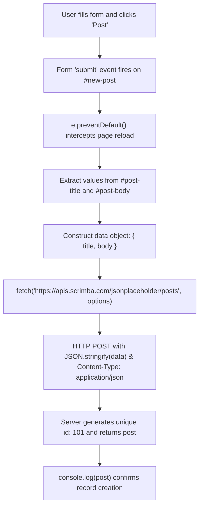

</details>

### 📝 Quiz & Recap

> [!NOTE]
> **How does sending a new blog post connect all previous REST concepts together?**
>
> - **Answer:** It connects form event handling (`e.preventDefault()`), DOM value extraction, payload serialization (`JSON.stringify()`), HTTP method specification (`POST`), and content metadata headers (`"Content-Type": "application/json"`) into a unified client-server communication cycle.

> [!TIP]
> **What role does `"Content-Type": "application/json"` play in this form submission?**
>
> - **Answer:** It informs the server's body-parsing middleware that the payload payload is structured as JSON so the server can deserialize it into an object with `.title` and `.body` properties. Without it, the server would treat the payload as plain text and fail to parse it.

> [!IMPORTANT]
> **Why does JSONPlaceholder return an object with `id: 101` when posting a new article?**
>
> - **Answer:** JSONPlaceholder contains 100 default posts. When you submit a valid `POST` request to `/posts`, it simulates creating a new record by auto-incrementing the ID to `101` and returning the submitted data back to the client.

### 💻 Code Implementation

You can explore the source files for this practice below:

- [index.html](<file:///c:/Users/suyas/Downloads/CODING%281%29/NEXTGEN-CODE/05-07-2026/APIs%20and%20Async%20JavaScript/URLs%20and%20REST/BlogSpace%20-%20Send%20new%20post%20to%20server/index.html>) - Markup with `#new-post` form and `#blog-list` container.
- [index.css](<file:///c:/Users/suyas/Downloads/CODING%281%29/NEXTGEN-CODE/05-07-2026/APIs%20and%20Async%20JavaScript/URLs%20and%20REST/BlogSpace%20-%20Send%20new%20post%20to%20server/index.css>) - Styles defining the fixed navigation bar and form layout.
- [index.js](<file:///c:/Users/suyas/Downloads/CODING%281%29/NEXTGEN-CODE/05-07-2026/APIs%20and%20Async%20JavaScript/URLs%20and%20REST/BlogSpace%20-%20Send%20new%20post%20to%20server/index.js>) - Form submit listener executing the `fetch()` POST request with serialized body and headers.
- [package.json](<file:///c:/Users/suyas/Downloads/CODING%281%29/NEXTGEN-CODE/05-07-2026/APIs%20and%20Async%20JavaScript/URLs%20and%20REST/BlogSpace%20-%20Send%20new%20post%20to%20server/package.json>) - Project metadata and dependencies.
- [vite.config.js](<file:///c:/Users/suyas/Downloads/CODING%281%29/NEXTGEN-CODE/05-07-2026/APIs%20and%20Async%20JavaScript/URLs%20and%20REST/BlogSpace%20-%20Send%20new%20post%20to%20server/vite.config.js>) - Vite configuration.

```javascript
// Intercept form submission and send new post to server via HTTP POST
document.getElementById("new-post").addEventListener("submit", function(e) {
    e.preventDefault();
    const postTitle = document.getElementById("post-title").value;
    const postBody = document.getElementById("post-body").value;
    const data = {
        title: postTitle,
        body: postBody
    };

    fetch("https://apis.scrimba.com/jsonplaceholder/posts", {
        method: "POST",
        body: JSON.stringify(data),
        headers: {
            "Content-Type": "application/json"
        }
    })
        .then(res => res.json())
        .then(post => console.log(post));
});
```

### 🔗 Chapter 26 Resources

- 📄 **MDN Web Docs:** [Using Fetch - Uploading JSON Data](https://developer.mozilla.org/en-US/docs/Web/API/Fetch_API/Using_Fetch#uploading_json_data) — Sending JSON in request bodies with Fetch.
- 📄 **MDN Web Docs:** [HTMLFormElement: submit event](https://developer.mozilla.org/en-US/docs/Web/API/HTMLFormElement/submit_event) — Intercepting form submissions.
- 📄 **JSONPlaceholder:** [Creating a Resource Guide](https://jsonplaceholder.typicode.com/guide/) — Documentation for testing POST endpoints.
- 📄 **API Endpoint:** [JSONPlaceholder Posts Endpoint (Scrimba Proxy)](https://apis.scrimba.com/jsonplaceholder/posts) — Mock REST endpoint for blog posts.

---

## 📰 Chapter 27: BlogSpace — Add New Post to List of Posts

### Core Concept

Once an HTTP `POST` request successfully resolves, the application must update the user interface to reflect the newly created post. Rather than triggering an unnecessary second `GET` request or reloading the entire web page, modern frontend applications extract the response payload returned by the server and dynamically prepend the new entry to the live DOM feed.

- **Dynamic Feed Prepending (`newPostHtml + existingHtml`):**
  - Standard string concatenation via `+=` appends new content to the *bottom* of an element (`existingHtml + newPostHtml`).
  - For chronological feeds, reverse concatenation (`newPostHtml + blogList.innerHTML`) places the new HTML string before the existing children, prepending the latest post directly to the top of `#blog-list`.
- **Immediate Visual Feedback (Zero-Roundtrip Rendering):**
  - When the server responds with status `201 Created` or returns the parsed post record (`{ id, title, body }`), the client directly renders that object.
  - This avoids a second network round-trip to re-fetch the entire database collection, keeping performance optimal and rendering instant.
- **Form State Reset & Clean Lifecycle:**
  - After injecting the post, the submit handler completes the full lifecycle: user input &rarr; default prevention &rarr; POST payload serialization &rarr; server response parsing &rarr; live DOM update.

### 💡 Visualizations & Architecture

<details>
  <summary><b>📷 Expand to View Dynamic Prepend Flow Diagram</b></summary>
  <br>

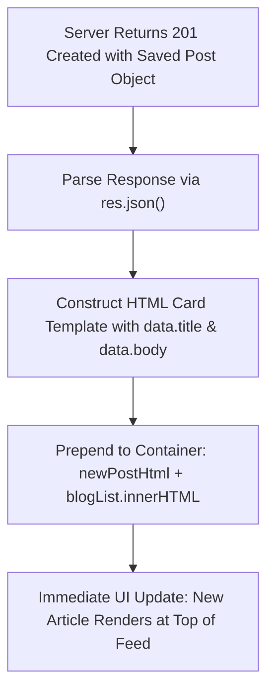

</details>

### 📝 Quiz & Recap

> [!NOTE]
> **Why is prepending (`newPostHtml + existingHtml`) preferred for a blog feed over appending?**
>
> - **Answer:** In blog feeds, news portals, and social media platforms, users expect newly published content to appear at the very top of the feed where it is immediately visible without scrolling down.

> [!TIP]
> **What is the benefit of rendering the post directly from the `POST` response instead of making another `GET` request?**
>
> - **Answer:** Rendering the object returned directly by the server eliminates an extra network round-trip, saves server resources and bandwidth, and provides instant, flicker-free visual feedback to the user.

> [!IMPORTANT]
> **How does `newPostHtml + document.getElementById("blog-list").innerHTML` place content at the beginning?**
>
> - **Answer:** In JavaScript string concatenation, the value placed on the left side of the `+` operator comes first in the resulting string. Placing `newPostHtml` before the existing `.innerHTML` ensures the new markup is evaluated and rendered at the top of the container.

### 💻 Code Implementation

You can explore the source files for this practice below:

- [index.html](<file:///c:/Users/suyas/Downloads/CODING%281%29/NEXTGEN-CODE/05-07-2026/APIs%20and%20Async%20JavaScript/URLs%20and%20REST/BlogSpace%20-%20Add%20new%20post%20to%20list%20of%20posts/index.html>) - Baseline HTML template linking the styled form and post container.
- [index.css](<file:///c:/Users/suyas/Downloads/CODING%281%29/NEXTGEN-CODE/05-07-2026/APIs%20and%20Async%20JavaScript/URLs%20and%20REST/BlogSpace%20-%20Add%20new%20post%20to%20list%20of%20posts/index.css>) - CSS layout styles.
- [index.js](<file:///c:/Users/suyas/Downloads/CODING%281%29/NEXTGEN-CODE/05-07-2026/APIs%20and%20Async%20JavaScript/URLs%20and%20REST/BlogSpace%20-%20Add%20new%20post%20to%20list%20of%20posts/index.js>) - Logic parsing the `POST` response and prepending the new post markup into the DOM.
- [package.json](<file:///c:/Users/suyas/Downloads/CODING%281%29/NEXTGEN-CODE/05-07-2026/APIs%20and%20Async%20JavaScript/URLs%20and%20REST/BlogSpace%20-%20Add%20new%20post%20to%20list%20of%20posts/package.json>) - Project metadata and dependencies.
- [vite.config.js](<file:///c:/Users/suyas/Downloads/CODING%281%29/NEXTGEN-CODE/05-07-2026/APIs%20and%20Async%20JavaScript/URLs%20and%20REST/BlogSpace%20-%20Add%20new%20post%20to%20list%20of%20posts/vite.config.js>) - Vite configuration.

```javascript
// Prepend newly created post to the top of the blog list upon successful POST response
fetch("https://apis.scrimba.com/jsonplaceholder/posts", options)
    .then(res => res.json())
    .then(data => {
        const newPostHtml = `
            <h3>${data.title}</h3>
            <p>${data.body}</p>
            <hr />
        `;
        document.getElementById("blog-list").innerHTML = 
            newPostHtml + document.getElementById("blog-list").innerHTML;
    });
```

### 🔗 Chapter 27 Resources

- 📄 **MDN Web Docs:** [Element.innerHTML](https://developer.mozilla.org/en-US/docs/Web/API/Element/innerHTML) — Reading and setting HTML markup of DOM elements.
- 📄 **MDN Web Docs:** [Element.insertAdjacentHTML()](https://developer.mozilla.org/en-US/docs/Web/API/Element/insertAdjacentHTML) — Alternative high-performance method for inserting HTML at specific positions (`afterbegin`).
- 📄 **MDN Web Docs:** [Using Fetch - Handling Responses](https://developer.mozilla.org/en-US/docs/Web/API/Fetch_API/Using_Fetch#response_objects) — Processing JSON payloads returned from server.
- 📄 **API Endpoint:** [JSONPlaceholder Posts Endpoint (Scrimba Proxy)](https://apis.scrimba.com/jsonplaceholder/posts) — Mock REST endpoint for blog posts.

---

## 🛠️ Chapter 28: BlogSpace — Posts Refactor

### Core Concept

As web applications grow in complexity, scattering DOM manipulation logic across multiple event handlers and fetch callbacks leads to code duplication, synchronization bugs, and difficult maintenance. In this chapter, we refactor **BlogSpace** by introducing a centralized state variable and a single, dedicated rendering function.

- **Single Source of Truth (`postsArray`):**
  - We establish a global array variable (`let postsArray = []`) to hold the live collection of post objects.
  - All operations that add or load data mutate this array first, rather than directly touching the DOM.
- **Dedicated Rendering Function (`renderPosts()`):**
  - Encapsulates template generation and DOM writing into a reusable function:
    ```javascript
    function renderPosts() {
        let html = "";
        for (let post of postsArray) {
            html += `
                <h3>${post.title}</h3>
                <p>${post.body}</p>
                <hr />
            `;
        }
        document.getElementById("blog-list").innerHTML = html;
    }
    ```
  - This eliminates duplicated markup and adheres strictly to the **DRY (Don't Repeat Yourself)** principle.
- **State Mutation with `Array.prototype.unshift()`:**
  - When the user submits a new post and the server returns the confirmed record, we prepend it to the beginning of the state array using `postsArray.unshift(post)`.
  - Calling `renderPosts()` immediately re-evaluates the array and updates the DOM, cleanly displaying the newest post at the top without ad-hoc string concatenation.
- **Transition to State-Driven Architecture:**
  - This pattern decouples data flow from presentation:
    $$
    \text{Network Request} \longrightarrow \text{State Mutation} \longrightarrow \text{Declarative Render}
    $$
  - Understanding this flow provides a direct conceptual bridge to modern reactive UI libraries like React and Vue.

### 💡 Visualizations & Architecture

<details>
  <summary><b>📷 Expand to View State-Driven Render Pipeline Diagram</b></summary>
  <br>

```mermaid
flowchart TD
    subgraph StateManagement ["Application State: postsArray"]
        State["postsArray = [ post1, post2, ... ]"]
    end

    FetchInitial["Initial GET /posts"] --> Sliced["data.slice(0, 5)"]
    Sliced --> AssignState["postsArray = slicedData"]
    AssignState --> TriggerRender1["renderPosts()"]

    UserPost["User Submits Form: POST /posts"] --> NewPost["Server returns new post object"]
    NewPost --> UnshiftState["postsArray.unshift(post)"]
    UnshiftState --> TriggerRender2["renderPosts()"]

    subgraph RenderEngine ["Centralized Render Function: renderPosts()"]
        TriggerRender1 --> Loop["Iterate over postsArray"]
        TriggerRender2 --> Loop
        Loop --> HTMLString["Build HTML markup string"]
        HTMLString --> UpdateDOM["blogList.innerHTML = html"]
    end
```

</details>

### 📝 Quiz & Recap

> [!NOTE]
> **Why is creating a single `renderPosts()` function better than writing separate rendering logic for GET and POST?**
>
> - **Answer:** It enforces the DRY (Don't Repeat Yourself) principle. Defining template HTML in one place means future UI changes (e.g., adding authors, timestamps, or styling classes) only need to be made once, preventing inconsistencies across the app.

> [!TIP]
> **How does `postsArray.unshift(post)` differ from `postsArray.push(post)`?**
>
> - **Answer:** `unshift()` adds new elements to the **beginning** (index 0) of an array, shifting existing elements downward. `push()` adds elements to the **end**. For reverse-chronological feeds (like blogs or social media), `unshift()` ensures the latest post appears first.

> [!IMPORTANT]
> **Why is decoupling state management from DOM rendering a best practice in frontend engineering?**
>
> - **Answer:** When the DOM is treated as a direct reflection of underlying state (`State -> View`), code becomes predictable, easier to test, and simpler to debug. Components modify state, and a single render mechanism ensures the UI stays synchronized with that state.

### 💻 Code Implementation

You can explore the source files for this practice below:

- [index.html](<file:///c:/Users/suyas/Downloads/CODING%281%29/NEXTGEN-CODE/05-07-2026/APIs%20and%20Async%20JavaScript/URLs%20and%20REST/BlogSpace%20-%20Posts%20Refactor/index.html>) - Baseline HTML template linking styled form and blog feed.
- [index.css](<file:///c:/Users/suyas/Downloads/CODING%281%29/NEXTGEN-CODE/05-07-2026/APIs%20and%20Async%20JavaScript/URLs%20and%20REST/BlogSpace%20-%20Posts%20Refactor/index.css>) - Fixed navbar, layout, and form CSS rules.
- [index.js](<file:///c:/Users/suyas/Downloads/CODING%281%29/NEXTGEN-CODE/05-07-2026/APIs%20and%20Async%20JavaScript/URLs%20and%20REST/BlogSpace%20-%20Posts%20Refactor/index.js>) - Refactored script introducing `postsArray`, `renderPosts()`, and `unshift()`.
- [package.json](<file:///c:/Users/suyas/Downloads/CODING%281%29/NEXTGEN-CODE/05-07-2026/APIs%20and%20Async%20JavaScript/URLs%20and%20REST/BlogSpace%20-%20Posts%20Refactor/package.json>) - Project metadata and dev server configuration.
- [vite.config.js](<file:///c:/Users/suyas/Downloads/CODING%281%29/NEXTGEN-CODE/05-07-2026/APIs%20and%20Async%20JavaScript/URLs%20and%20REST/BlogSpace%20-%20Posts%20Refactor/vite.config.js>) - Vite build settings.

```javascript
// State-driven rendering architecture
let postsArray = [];

function renderPosts() {
    let html = "";
    for (let post of postsArray) {
        html += `
            <h3>${post.title}</h3>
            <p>${post.body}</p>
            <hr />
        `;
    }
    document.getElementById("blog-list").innerHTML = html;
}

// Initial GET request populates state and renders
fetch("https://apis.scrimba.com/jsonplaceholder/posts")
    .then(res => res.json())
    .then(data => {
        postsArray = data.slice(0, 5);
        renderPosts();
    });

// POST request prepends new post to state and re-renders
document.getElementById("new-post").addEventListener("submit", function(e) {
    e.preventDefault();
    const postTitle = document.getElementById("post-title").value;
    const postBody = document.getElementById("post-body").value;
    const data = { title: postTitle, body: postBody };

    fetch("https://apis.scrimba.com/jsonplaceholder/posts", {
        method: "POST",
        body: JSON.stringify(data),
        headers: { "Content-Type": "application/json" }
    })
        .then(res => res.json())
        .then(post => {
            postsArray.unshift(post);
            renderPosts();
        });
});
```

### 🔗 Chapter 28 Resources

- 📄 **MDN Web Docs:** [Array.prototype.unshift()](https://developer.mozilla.org/en-US/docs/Web/JavaScript/Reference/Global_Objects/Array/unshift) — Inserting elements at the start of an array.
- 📄 **MDN Web Docs:** [JavaScript Functions](https://developer.mozilla.org/en-US/docs/Web/JavaScript/Guide/Functions) — Reusable blocks of logic.
- 📄 **MDN Web Docs:** [State Management Basics](https://developer.mozilla.org/en-US/docs/Learn/JavaScript/Client-side_web_APIs/Manipulating_documents) — Managing DOM changes via centralized state.
- 📄 **API Endpoint:** [JSONPlaceholder Posts Endpoint (Scrimba Proxy)](https://apis.scrimba.com/jsonplaceholder/posts) — Mock REST endpoint for blog posts.

---

## 🧹 Chapter 29: BlogSpace — Reset Form

### Core Concept

Completing the user submission lifecycle requires returning the application interface to an intuitive, ready state. In this chapter, we optimize DOM access by caching input elements and clear the form controls upon a successful server response so users can compose subsequent posts seamlessly.

- **DOM Element Reference Caching:**
  - Instead of repeatedly executing `document.getElementById("post-title")` and `document.getElementById("post-body")` every time a submission occurs, we cache the references once at the module level:
    ```javascript
    const titleInput = document.getElementById("post-title");
    const bodyInput = document.getElementById("post-body");
    ```
  - This improves performance and eliminates redundant DOM lookups.
- **Form Clearing Post-Submission (`.value = ""`):**
  - Once the `POST` request resolves successfully and the DOM has updated via `renderPosts()`, resetting the input controls clears the form:
    ```javascript
    titleInput.value = "";
    bodyInput.value = "";
    ```
  - Alternatively, invoking `form.reset()` on the parent `<form>` element resets all encapsulated controls.
- **Asynchronous User Feedback & UX Safeguards:**
  - Clearing the form inputs is placed inside the `.then(post => { ... })` callback rather than synchronously outside the fetch call.
  - If a network error or server rejection occurs, the user's drafted title and body remain intact in the fields, avoiding accidental data loss.

### 💡 Visualizations & Architecture

<details>
  <summary><b>📷 Expand to View Form Reset Lifecycle Diagram</b></summary>
  <br>

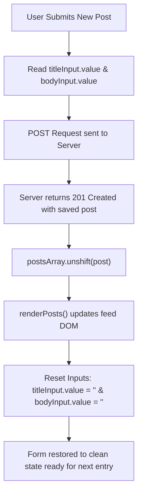

</details>

### 📝 Quiz & Recap

> [!NOTE]
> **Why is caching DOM element references at the top of the file recommended?**
>
> - **Answer:** Querying the DOM via `document.getElementById()` requires traversing the DOM tree. Caching the element references in variables once at the top of the script avoids repeated tree lookups on every submission, improving code cleanliness and runtime efficiency.

> [!TIP]
> **What is the difference between setting `.value = ""` on individual inputs versus calling `form.reset()`?**
>
> - **Answer:** Manually assigning `.value = ""` allows clearing specific target controls while preserving others (e.g. keeping a category or author field). Calling `document.getElementById("form-id").reset()` resets all fields within the form back to their default values in a single method call.

> [!IMPORTANT]
> **Why should form inputs only be cleared inside the `.then()` resolution block rather than right after the `fetch()` call?**
>
> - **Answer:** Network requests are asynchronous and may fail due to loss of internet connection, server downtime, or invalid credentials. If inputs are cleared before the server confirms success, the user loses their typed draft and cannot retry without retyping everything.

### 💻 Code Implementation

You can explore the source files for this practice below:

- [index.html](<file:///c:/Users/suyas/Downloads/CODING%281%29/NEXTGEN-CODE/05-07-2026/APIs%20and%20Async%20JavaScript/URLs%20and%20REST/BlogSpace%20-%20Reset%20form/index.html>) - Baseline HTML template linking styled form and blog feed.
- [index.css](<file:///c:/Users/suyas/Downloads/CODING%281%29/NEXTGEN-CODE/05-07-2026/APIs%20and%20Async%20JavaScript/URLs%20and%20REST/BlogSpace%20-%20Reset%20form/index.css>) - CSS layout styles.
- [index.js](<file:///c:/Users/suyas/Downloads/CODING%281%29/NEXTGEN-CODE/05-07-2026/APIs%20and%20Async%20JavaScript/URLs%20and%20REST/BlogSpace%20-%20Reset%20form/index.js>) - Script caching DOM nodes and clearing fields upon successful post creation.
- [package.json](<file:///c:/Users/suyas/Downloads/CODING%281%29/NEXTGEN-CODE/05-07-2026/APIs%20and%20Async%20JavaScript/URLs%20and%20REST/BlogSpace%20-%20Reset%20form/package.json>) - Project dependencies and scripts.
- [vite.config.js](<file:///c:/Users/suyas/Downloads/CODING%281%29/NEXTGEN-CODE/05-07-2026/APIs%20and%20Async%20JavaScript/URLs%20and%20REST/BlogSpace%20-%20Reset%20form/vite.config.js>) - Vite configuration.

```javascript
// Cached DOM references
const titleInput = document.getElementById("post-title");
const bodyInput = document.getElementById("post-body");

// Clear form inputs after updating state and re-rendering
fetch("https://apis.scrimba.com/jsonplaceholder/posts", options)
    .then(res => res.json())
    .then(post => {
        postsArray.unshift(post);
        renderPosts();
        titleInput.value = "";
        bodyInput.value = "";
    });
```

### 🔗 Chapter 29 Resources

- 📄 **MDN Web Docs:** [HTMLInputElement: value](https://developer.mozilla.org/en-US/docs/Web/API/HTMLInputElement#value) — Reading and setting input field values.
- 📄 **MDN Web Docs:** [HTMLFormElement: reset()](https://developer.mozilla.org/en-US/docs/Web/API/HTMLFormElement/reset) — Resetting form controls.
- 📄 **MDN Web Docs:** [Document: getElementById()](https://developer.mozilla.org/en-US/docs/Web/API/Document/getElementById) — DOM element retrieval and caching.
- 📄 **API Endpoint:** [JSONPlaceholder Posts Endpoint (Scrimba Proxy)](https://apis.scrimba.com/jsonplaceholder/posts) — Mock REST endpoint for blog posts.

---

## 🌐 Chapter 30: REST (Representational State Transfer)

### Core Concept

**REST (REpresentational State Transfer)** is an architectural design pattern and set of guiding constraints that provide a standardized convention for communication between clients and servers over the internet.

- **What Does REST Mean?**
  - **Representational:** Data is requested and transferred in a standardized representation (most commonly **JSON**).
  - **State:** The current data snapshot of a resource stored in the system (e.g. database records).
  - **Transfer:** Moving representations of that state across the network between the client and server.
- **Key Principles of REST Architecture:**
  1. **Client & Server Separation:**
     - The server's primary responsibility is storing, managing, and delivering raw data payloads via HTTP endpoints.
     - The server does not dictate how that data is visually presented.
     - Heterogeneous clients (laptops, mobile phones, smartwatches, smart TVs) make HTTP requests to the same unified REST API, receive JSON, and render their own platform-specific interfaces.
  2. **Statelessness:**
     - Every incoming request from a client must contain all necessary context, credentials, and parameters needed for the server to process it.
     - The server does not retain client session state between requests, maximizing scalability and resilience.
  3. **Accessing Resources via Standardized Endpoints (Nouns vs. Verbs):**
     - **Nouns (Endpoints):** URLs specify the **resource** or collection being accessed (e.g., `/bikes`, `/posts`, `/users`).
     - **Verbs (HTTP Methods):** The HTTP method indicates the **action** performed on that resource:
       - `GET /bikes` &rarr; Retrieve all bicycle items.
       - `POST /bikes` &rarr; Create a new bicycle item.
       - `GET /bikes/123` &rarr; Retrieve the specific bicycle with ID `123`.
       - `PUT /bikes/123` &rarr; Replace or update bicycle `123`.
       - `DELETE /bikes/123` &rarr; Remove bicycle `123`.

### 💡 Visualizations & Architecture

<details>
  <summary><b>📷 Expand to View REST Architectural Visualizations & Flow Diagram</b></summary>
  <br>

### 1. What is REST?

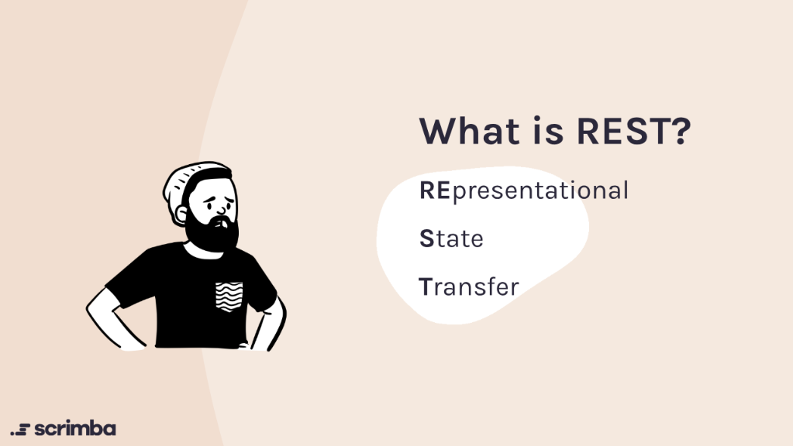

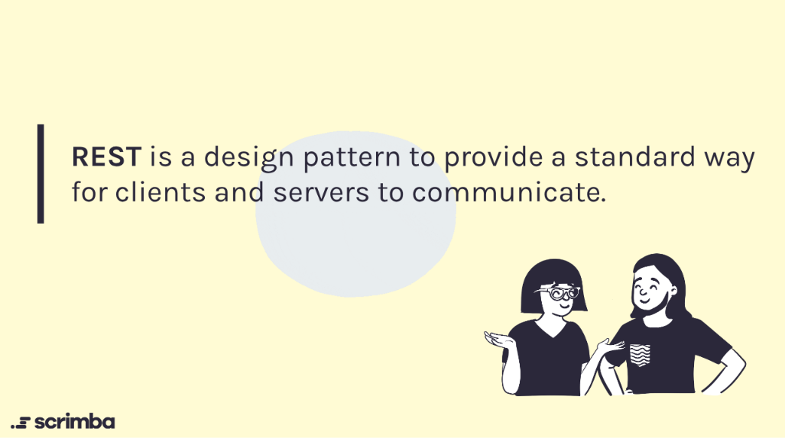

### 2. Client & Server Separation Across Devices

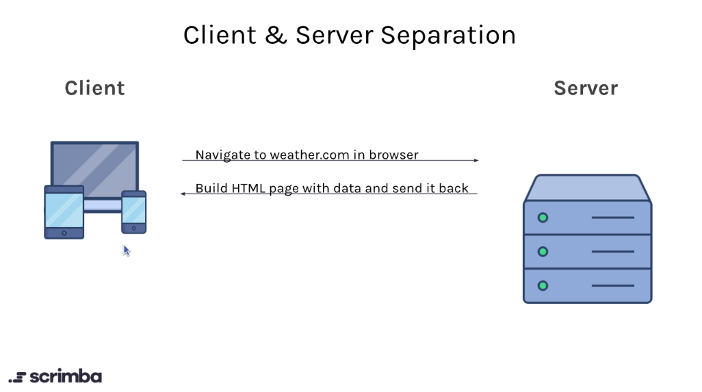

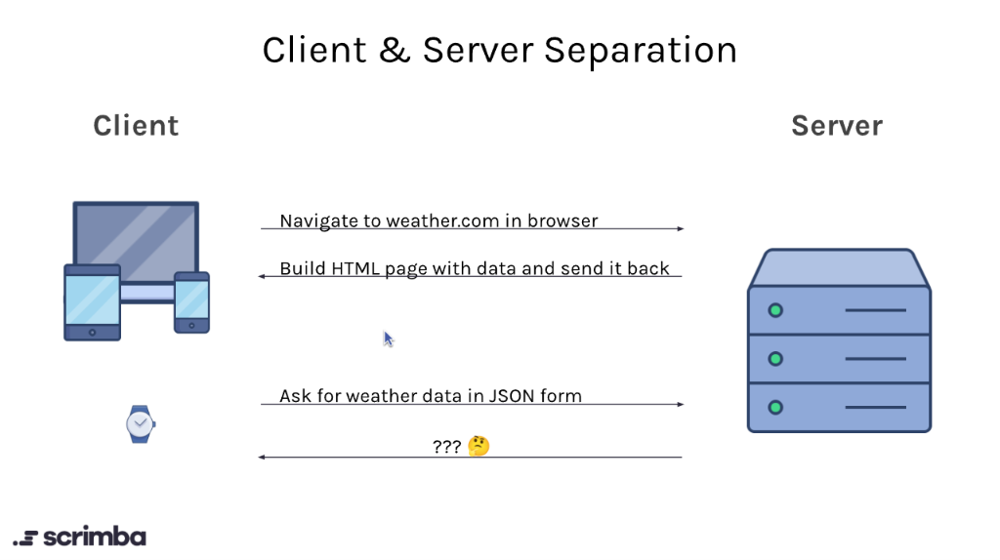


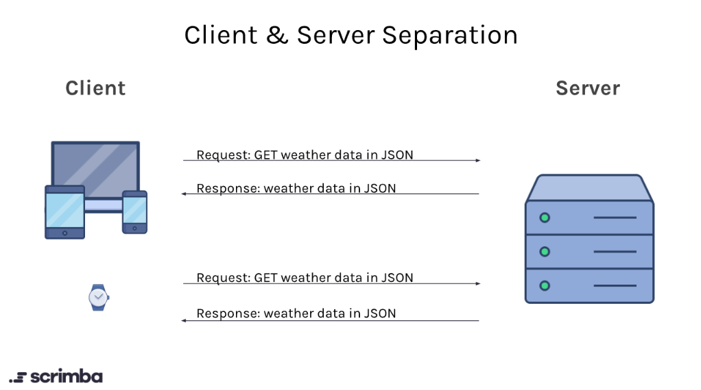

### 3. Core Principles of REST

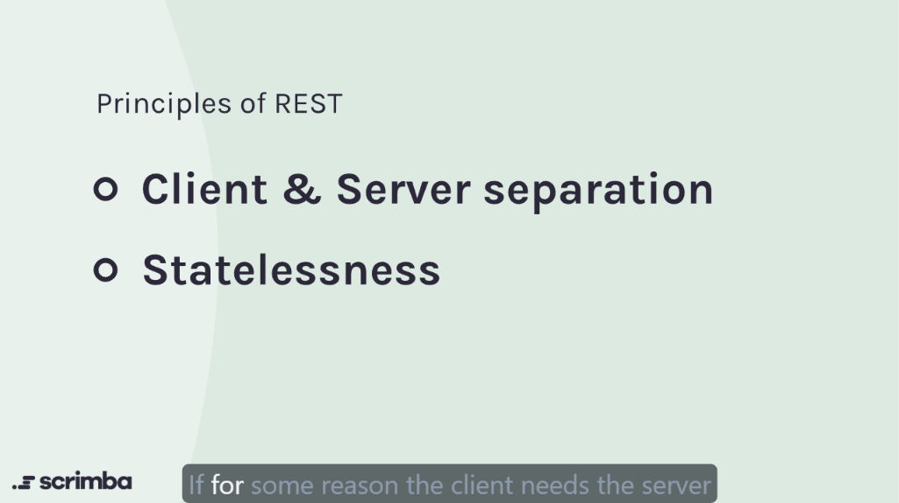

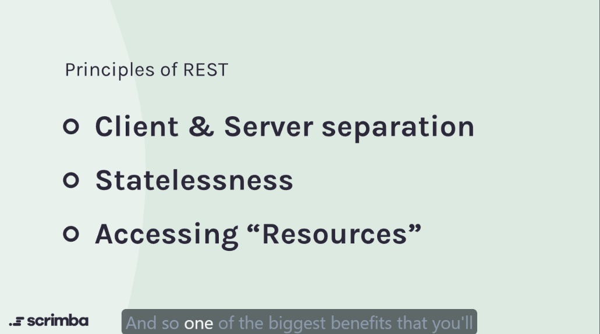

### 4. Interacting with Resources (Nouns vs. Verbs)

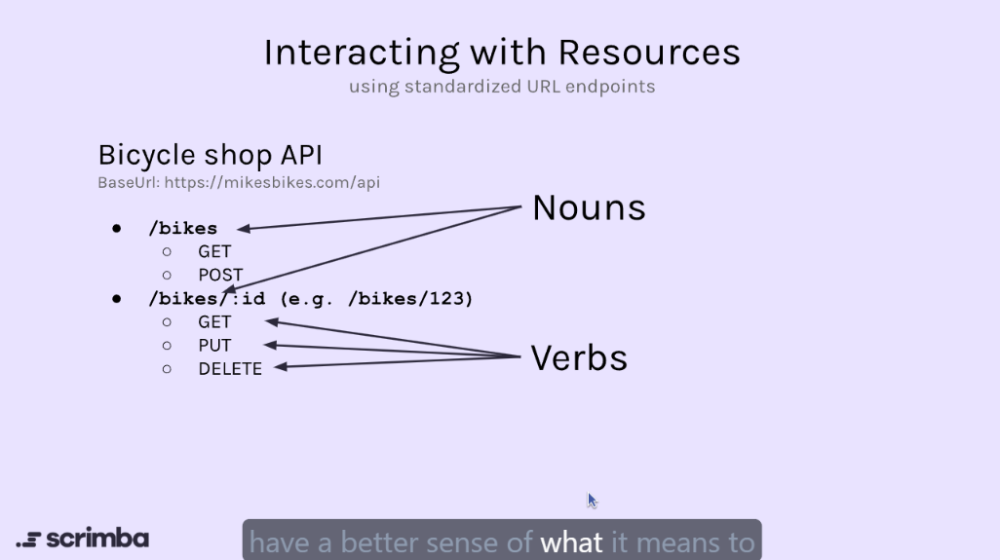

### 5. Architectural REST Communication Diagram

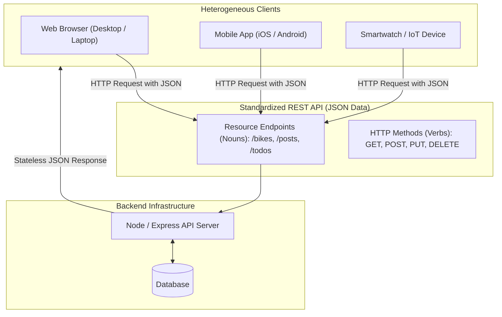

</details>

### 📝 Quiz & Recap

_(Original file: [quiz.md](<file:///c:/Users/suyas/Downloads/CODING%281%29/NEXTGEN-CODE/05-07-2026/APIs%20and%20Async%20JavaScript/URLs%20and%20REST/REST/quiz.md>))_

> [!NOTE]
> **How would you describe what REST is to your non-technical friend?**
>
> - **Answer:** A standardized way to have your computer, like your laptop or phone, get or send information to another computer (like a server) across the internet.

> [!TIP]
> **What does a RESTful API usually return in response to incoming requests?**
>
> - **Answer:** **JSON data** (JavaScript Object Notation). Because JSON is universally supported, any client application can parse it and render a native user interface.

> [!IMPORTANT]
> **What kind of client devices can make use of a RESTful API?**
>
> - **Answer:** **ALL OF THEM.** Desktop web browsers, mobile phones, tablets, smartwatches, voice assistants, and IoT appliances can all consume the same RESTful API endpoints.

### 💻 Code Implementation

You can explore the source files for this practice below:

- [quiz.md](<file:///c:/Users/suyas/Downloads/CODING%281%29/NEXTGEN-CODE/05-07-2026/APIs%20and%20Async%20JavaScript/URLs%20and%20REST/REST/quiz.md>) - Knowledge check on REST principles, JSON data formats, and client device versatility.
- [README.md](<file:///c:/Users/suyas/Downloads/CODING%281%29/NEXTGEN-CODE/05-07-2026/APIs%20and%20Async%20JavaScript/URLs%20and%20REST/REST/README.md>) - Getting started instructions for running the lesson sandbox.
- [package.json](<file:///c:/Users/suyas/Downloads/CODING%281%29/NEXTGEN-CODE/05-07-2026/APIs%20and%20Async%20JavaScript/URLs%20and%20REST/REST/package.json>) - Project dependencies and scripts.
- [vite.config.js](<file:///c:/Users/suyas/Downloads/CODING%281%29/NEXTGEN-CODE/05-07-2026/APIs%20and%20Async%20JavaScript/URLs%20and%20REST/REST/vite.config.js>) - Vite configuration.

```javascript
// RESTful API Endpoint Pattern: Nouns (Resources) paired with Verbs (HTTP Methods)
const baseUrl = "https://example.com/api";

// 1. GET /bikes - Retrieve list of all bicycle resources
fetch(`${baseUrl}/bikes`)
    .then(res => res.json())
    .then(bikes => console.log(bikes));

// 2. POST /bikes - Create a new bicycle resource
fetch(`${baseUrl}/bikes`, {
    method: "POST",
    headers: { "Content-Type": "application/json" },
    body: JSON.stringify({ model: "Mountain Pro", price: 499 })
})
    .then(res => res.json())
    .then(newBike => console.log(newBike));

// 3. GET /bikes/123 - Retrieve specific bike resource by ID
fetch(`${baseUrl}/bikes/123`)
    .then(res => res.json())
    .then(bike => console.log(bike));

// 4. DELETE /bikes/123 - Delete specific bike resource
fetch(`${baseUrl}/bikes/123`, { method: "DELETE" })
    .then(res => console.log("Resource deleted:", res.status));
```

### 🔗 Chapter 30 Resources

- 📄 **MDN Web Docs:** [REST Glossary](https://developer.mozilla.org/en-US/docs/Glossary/REST) — Formal definition of Representational State Transfer.
- 📄 **MDN Web Docs:** [HTTP Request Methods](https://developer.mozilla.org/en-US/docs/Web/HTTP/Methods) — Verbs used to indicate desired actions on resources.
- 📄 **REST API Tutorial:** [What is REST?](https://restfulapi.net/) — Constraints, principles, and architectural best practices.

---

## 📐 Chapter 31: REST API Design

### Core Concept

Building on the foundation of Representational State Transfer, **REST API Design** focuses on structuring endpoints intuitively using standard conventions. By adhering to uniform patterns, developers create APIs that are self-documenting, predictable, and easy to consume across any client platform.

- **Stateless Server Architecture:**
  - A RESTful server is **stateless**: it does not preserve client session history between requests.
  - Once a response is returned, the server "forgets" the interaction.
  - Every incoming request must carry all required authentication headers, resource parameters, and payload data necessary for the server to fulfill the request.
- **The "Nouns + Verbs" Design Convention (Mike's Bikes Model):**
  - Rather than defining custom URL paths for every action (e.g. `/getBikes`, `/createBike`, `/deleteBike?id=56`), REST uses clean **plural nouns** for endpoints and standardized **HTTP methods** as actions:| Action / Requirement     | HTTP Method (Verb) | URL Endpoint (Noun) | Description                                         |
    | :----------------------- | :----------------: | :------------------ | :-------------------------------------------------- |
    | **Retrieve All**   |      `GET`      | `/bikes`          | Fetches collection of all available bicycle records |
    | **Retrieve By ID** |      `GET`      | `/bikes/42`       | Fetches specific details for bike with ID `42`    |
    | **Update Record**  |      `PUT`      | `/bikes/21`       | Updates price or attributes of bike with ID `21`  |
    | **Create Record**  |      `POST`      | `/bikes`          | Submits new bicycle item to be created in database  |
    | **Delete Record**  |     `DELETE`     | `/bikes/56`       | Removes bicycle item with ID `56` from database   |
- **Benefits of RESTful API Design:**
  - **Predictability:** Developers familiar with REST can deduce how to interact with new endpoints without consulting extensive documentation.
  - **Scalability:** Stateless requests can be routed to any available backend server or container without sharing session state.
  - **Clean Separation:** Frontend interfaces focus strictly on user experience, while backend services manage business rules and persistence.

### 💡 Visualizations & Architecture

<details>
  <summary><b>📷 Expand to View REST API Routing Matrix Diagram</b></summary>
  <br>

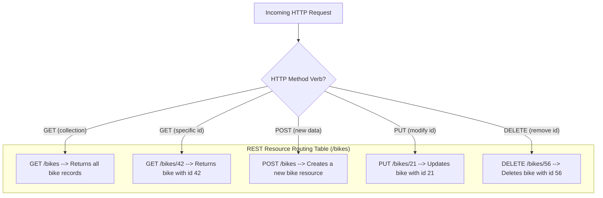

</details>

### 📝 Quiz & Recap

_(Original file: [quiz.md](<file:///c:/Users/suyas/Downloads/CODING%281%29/NEXTGEN-CODE/05-07-2026/APIs%20and%20Async%20JavaScript/URLs%20and%20REST/REST%20API%20Design/quiz.md>))_

> [!NOTE]
> **What does it mean for a server to be "Stateless"?**
>
> - **Answer:** It forgets the interaction immediately after the response is sent. The server does not store past interaction history or client session state across separate requests.

> [!TIP]
> **Why are URL endpoints formatted as plural nouns (`/bikes`) rather than verbs (`/getBikes` or `/updateBikes`)?**
>
> - **Answer:** The HTTP method already acts as the verb specifying the action. Using plural nouns for endpoints keeps the URL space clean and focused on resources, ensuring that the same URL path supports multiple actions (`GET`, `POST`, `PUT`, `DELETE`).

> [!IMPORTANT]
> **In the Mike's Bikes API example, what HTTP method and endpoint achieve each operation?**
>
> - **Retrieve list of all bikes:** `GET /bikes`
> - **Retrieve detailed info for bike #42:** `GET /bikes/42`
> - **Update price of bike #21:** `PUT /bikes/21`
> - **Add a new bike to inventory:** `POST /bikes`
> - **Remove bike #56 from list:** `DELETE /bikes/56`

### 💻 Code Implementation

You can explore the source files for this practice below:

- [quiz.md](<file:///c:/Users/suyas/Downloads/CODING%281%29/NEXTGEN-CODE/05-07-2026/APIs%20and%20Async%20JavaScript/URLs%20and%20REST/REST%20API%20Design/quiz.md>) - Knowledge check on statelessness and the Mike's Bikes CRUD endpoint mapping.
- [README.md](<file:///c:/Users/suyas/Downloads/CODING%281%29/NEXTGEN-CODE/05-07-2026/APIs%20and%20Async%20JavaScript/URLs%20and%20REST/REST%20API%20Design/README.md>) - Sandbox execution guide.
- [package.json](<file:///c:/Users/suyas/Downloads/CODING%281%29/NEXTGEN-CODE/05-07-2026/APIs%20and%20Async%20JavaScript/URLs%20and%20REST/REST%20API%20Design/package.json>) - Project metadata and scripts.
- [vite.config.js](<file:///c:/Users/suyas/Downloads/CODING%281%29/NEXTGEN-CODE/05-07-2026/APIs%20and%20Async%20JavaScript/URLs%20and%20REST/REST%20API%20Design/vite.config.js>) - Vite configuration.

```javascript
// Complete Mike's Bikes RESTful CRUD API Implementation
const baseApi = "https://mikesbikes.com/api";

// 1. GET /bikes - Retrieve all bikes
fetch(`${baseApi}/bikes`)
    .then(res => res.json())
    .then(bikes => console.log("All bikes:", bikes));

// 2. GET /bikes/42 - Retrieve specific bike by ID
fetch(`${baseApi}/bikes/42`)
    .then(res => res.json())
    .then(bike => console.log("Bike 42:", bike));

// 3. PUT /bikes/21 - Update price for bike 21
fetch(`${baseApi}/bikes/21`, {
    method: "PUT",
    headers: { "Content-Type": "application/json" },
    body: JSON.stringify({ price: 299 })
})
    .then(res => res.json())
    .then(updated => console.log("Updated bike 21:", updated));

// 4. POST /bikes - Add a new bike
fetch(`${baseApi}/bikes`, {
    method: "POST",
    headers: { "Content-Type": "application/json" },
    body: JSON.stringify({ model: "Trailblazer 500", price: 449 })
})
    .then(res => res.json())
    .then(created => console.log("Created bike:", created));

// 5. DELETE /bikes/56 - Remove bike 56
fetch(`${baseApi}/bikes/56`, { method: "DELETE" })
    .then(res => console.log("Deleted bike 56, status:", res.status));
```

### 🔗 Chapter 31 Resources

- 📄 **MDN Web Docs:** [HTTP Request Methods](https://developer.mozilla.org/en-US/docs/Web/HTTP/Methods) — In-depth reference for GET, POST, PUT, DELETE, and PATCH.
- 📄 **MDN Web Docs:** [Understanding RESTful Architecture](https://developer.mozilla.org/en-US/docs/Glossary/REST) — Core tenets of REST systems.
- 📄 **REST API Guidelines:** [Zalando RESTful API Guidelines](https://opensource.zalando.com/restful-api-guidelines/) — Industry standards for resource naming, plural nouns, and idempotent actions.

---

## 🌳 Chapter 32: Nested Resources

In RESTful API design, resources rarely exist in isolation. Entities frequently maintain hierarchical **parent-child relationships** (e.g., a bike has multiple customer reviews, an author has multiple blog posts, a user has multiple orders). **Nested resources** reflect this hierarchy directly in the URL structure by chaining resource paths together.

### 🔑 Core Concepts

1. **Parent-to-Child URL Hierarchy:**
   - Instead of flattening everything into disconnected top-level endpoints, dependent resources are accessed under their parent identifier:
     - `/bikes`: Collection of all bikes.
     - `/bikes/:id`: Single specific bike.
     - `/bikes/:id/reviews`: Collection of reviews belonging **strictly** to that specific bike.
     - `/bikes/:id/reviews/:reviewId`: A specific review on that specific bike.
2. **URL Parameters (`:id`, `:reviewId`):**
   - Variables placed inside the URL path acting as dynamic placeholders for real values (typically resource IDs or slugs).
   - In documentation or routing frameworks (like Express or React Router), they are marked with a leading colon (`:id`). At runtime, client requests supply concrete values like `/bikes/123/reviews/5`.
3. **Scoped vs. Global Endpoints:**
   - `/bikes/123/reviews` &rarr; Scoped query returning only reviews for bike `123`.
   - `/reviews` &rarr; Global query returning every review across the entire platform.

<details>
<summary>📸 Visual Slide: Nested Resources & URL Parameters</summary>

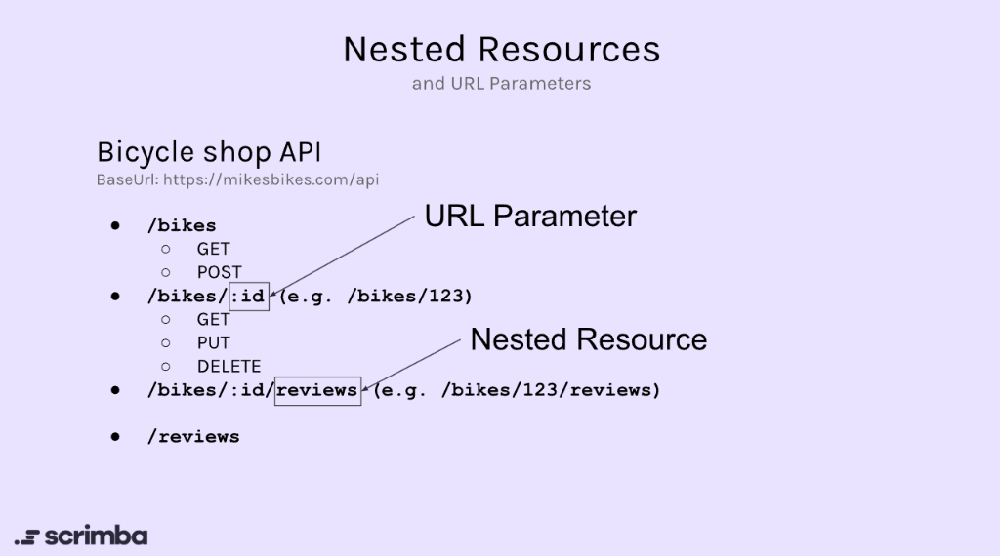

</details>

### 🗺️ Hierarchical Resource Architecture

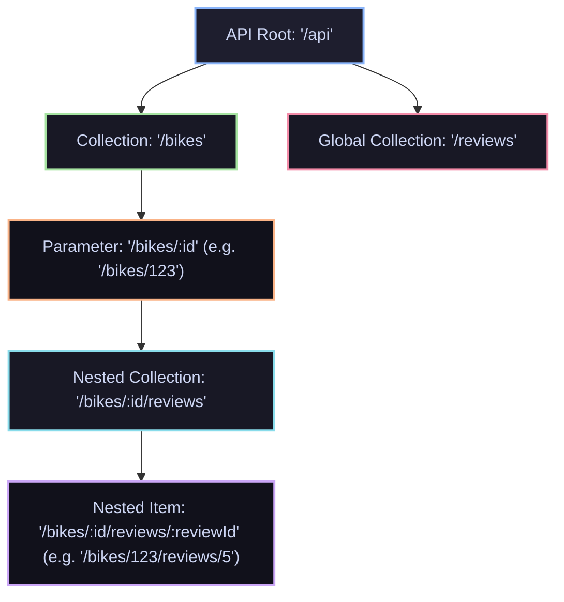

### 💡 Nested Resources Recap

> [!IMPORTANT]
> **Scoped vs. Global Querying:**
> A nested endpoint like `/bikes/123/reviews` explicitly scopes results to the parent entity (returning only reviews written for bike `123`), whereas a top-level `/reviews` endpoint accesses the entire unconstrained pool of reviews across all bikes in the database.

> [!TIP]
> **Drilling Down to Individual Nested Items:**
> When accessing a specific child item within a parent collection, append its identifier to the nested path: `/bikes/123/reviews/5` fetches review `5` under bike `123`.

> [!NOTE]
> **URL Parameters Defined:**
> A URL Parameter is a dynamic variable inside the endpoint path that acts as a placeholder for a runtime value—frequently replacing the unique ID or identifier of the target resource.

### 💻 Code Implementation & Practice

Practice files for this chapter are available in [Nested Resources](<file:///c:/Users/suyas/Downloads/CODING%281%29/NEXTGEN-CODE/05-07-2026/APIs%20and%20Async%20JavaScript/URLs%20and%20REST/Nested%20Resources>) ([quiz.md](<file:///c:/Users/suyas/Downloads/CODING%281%29/NEXTGEN-CODE/05-07-2026/APIs%20and%20Async%20JavaScript/URLs%20and%20REST/Nested%20Resources/quiz.md>)):

```javascript
// Nested Resources & URL Parameters Demo
const baseApi = "https://mikesbikes.com/api";

const bikeId = 123;
const reviewId = 5;

// 1. Fetch all reviews belonging exclusively to bike 123 (Scoped)
fetch(`${baseApi}/bikes/${bikeId}/reviews`)
    .then(res => res.json())
    .then(reviews => console.log(`Reviews for bike ${bikeId}:`, reviews));

// 2. Fetch a specific review (review 5) on bike 123 (Nested Resource by ID)
fetch(`${baseApi}/bikes/${bikeId}/reviews/${reviewId}`)
    .then(res => res.json())
    .then(review => console.log(`Review ${reviewId} for bike ${bikeId}:`, review));

// 3. Contrast: Fetch all reviews across the entire shop (Global)
fetch(`${baseApi}/reviews`)
    .then(res => res.json())
    .then(allReviews => console.log("All platform reviews:", allReviews));
```

### 🔗 Chapter 32 Resources

- 📄 **REST API Design Best Practices:** [Microsoft REST API Guidelines - Sub-collections](https://github.com/microsoft/api-guidelines/blob/vNext/Guidelines.md#72-sub-collections) — Standard conventions for modeling parent-child resources.
- 📄 **MDN Web Docs:** [How to Design a RESTful Web API](https://developer.mozilla.org/en-US/docs/Glossary/REST) — Deep dive into REST resource hierarchies and identification.
- 📄 **RFC 6570:** [URI Template Reference](https://datatracker.ietf.org/doc/html/rfc6570) — Standard specification for URI variables and path parameters.

---

## 🔍 Chapter 33: URL Parameters - JSONPlaceholder Nested Resources

Building upon the theory of nested resources, this practice applies parent-child URL routing to the industry-standard **JSONPlaceholder API** (`https://apis.scrimba.com/jsonplaceholder/`). We examine how real-world REST backends structure dependent data and how clients fetch scoped sub-collections (such as all comments belonging to a specific blog post) using dynamic path parameters.

### 🔑 Core Concepts

1. **Practical Nested Endpoint Resolution:**
   - In a blogging API, comments cannot exist without an associated post. The relationship is strictly hierarchical.
   - Endpoint: `/posts/:postId/comments`
   - Real Request: `GET https://apis.scrimba.com/jsonplaceholder/posts/2/comments`
   - Result: Returns an array of comment objects exclusively tied to post ID `2`.
2. **Path Nesting vs. Query Parameters:**
   - **Path Nesting (`/posts/2/comments`):** Directly expresses identity and ownership through URL semantics. The child resource collection is treated as an attribute of the parent.
   - **Query Parameters (`/comments?postId=2`):** Treats `/comments` as a global table and filters records matching criteria.
   - Both approaches are supported by JSONPlaceholder, but nested path parameters provide cleaner, self-documenting hierarchical API design.
3. **JSONPlaceholder Standard Nested Routes:**
   - `/posts/:id/comments` &rarr; Comments for a specific post.
   - `/albums/:id/photos` &rarr; Photos inside a specific album.
   - `/users/:id/albums` &rarr; Albums created by a specific user.
   - `/users/:id/todos` &rarr; Todo items assigned to a specific user.
   - `/users/:id/posts` &rarr; Blog posts authored by a specific user.

### 💡 Visualizations & Request Lifecycle

<details>
  <summary><b>📷 Expand to View JSONPlaceholder Nested Request Architecture</b></summary>
  <br>

```mermaid
flowchart LR
    Client["Client Browser ('fetch()')"] --> Req["HTTP GET '/jsonplaceholder/posts/2/comments'"]
    Req --> API["JSONPlaceholder Server"]
    API --> Filter["Resolve Parent: Post ID = 2"]
    Filter --> Extract["Extract Child Collection: Comments"]
    Extract --> Res["JSON Response Array: '[ { postId: 2, id: 6, ... } ]'"]
    Res --> Client

    style Client fill:#1e1e2e,stroke:#89b4fa,stroke-width:2px,color:#cdd6f4
    style Req fill:#181825,stroke:#f9e2af,stroke-width:2px,color:#cdd6f4
    style API fill:#181825,stroke:#a6e3a1,stroke-width:2px,color:#cdd6f4
    style Filter fill:#11111b,stroke:#fab387,stroke-width:2px,color:#cdd6f4
    style Extract fill:#11111b,stroke:#89dceb,stroke-width:2px,color:#cdd6f4
    style Res fill:#1e1e2e,stroke:#a6e3a1,stroke-width:2px,color:#cdd6f4
```

</details>

### 📝 Challenge & Recap

> [!IMPORTANT]
> **Hierarchical Ownership in URLs:**
> When accessing `/posts/2/comments`, the server handles the relational join behind the scenes, guaranteeing that every item in the returned array belongs exclusively to post `2`. No client-side array filtering (`Array.prototype.filter()`) is necessary.

> [!TIP]
> **API Documentation Exploration:**
> Always check the API provider's "Relations" or "Listing nested resources" section. If a nested route is not explicitly documented, test whether query parameter filtering (e.g., `?postId=2`) is the alternative pattern.

> [!NOTE]
> **Dynamic Interpolation in JavaScript:**
> In modern client code, avoid hardcoding IDs into string literals. Use ES6 template literals (`` `/posts/${postId}/comments` ``) to create reusable query functions.

### 💻 Code Implementation

Practice files for this chapter are available in [URL Parameters - JSON Placeholder API](<file:///c:/Users/suyas/Downloads/CODING%281%29/NEXTGEN-CODE/05-07-2026/APIs%20and%20Async%20JavaScript/URLs%20and%20REST/URL%20Parameters%20-%20JSON%20Placeholder%20API>) ([index.js](<file:///c:/Users/suyas/Downloads/CODING%281%29/NEXTGEN-CODE/05-07-2026/APIs%20and%20Async%20JavaScript/URLs%20and%20REST/URL%20Parameters%20-%20JSON%20Placeholder%20API/index.js>)):

```javascript
/**
 * Challenge: GET all the comments from the blog post with ID of 2 and log to the console
 * 
 * BaseURL: https://apis.scrimba.com/jsonplaceholder/
 * Endpoint: /posts/2/comments
 */

// Basic Fetch Implementation
fetch("https://apis.scrimba.com/jsonplaceholder/posts/2/comments")
    .then(res => res.json())
    .then(data => console.log("Comments for post 2:", data));

// Reusable Dynamic Parameter Function
function getPostComments(postId) {
    const baseUrl = "https://apis.scrimba.com/jsonplaceholder";
    return fetch(`${baseUrl}/posts/${postId}/comments`)
        .then(res => {
            if (!res.ok) {
                throw new Error(`HTTP error! Status: ${res.status}`);
            }
            return res.json();
        });
}

// Example usage: Fetch comments for post ID 5
getPostComments(5)
    .then(comments => console.log("Comments for post 5:", comments))
    .catch(err => console.error("Fetch failed:", err));
```

### 🔗 Chapter 33 Resources

- 📄 **JSONPlaceholder Guide:** [Listing Nested Resources Guide](https://jsonplaceholder.typicode.com/guide/) — Documentation of official relation routes for posts, comments, albums, and users.
- 📄 **MDN Web Docs:** [Using the Fetch API](https://developer.mozilla.org/en-US/docs/Web/API/Fetch_API/Using_Fetch) — Fetching data asynchronously with promises and response parsing.
- 📄 **REST API Tutorial:** [RESTful URL Path Design](https://restfulapi.net/resource-naming/) — Industry standards for modeling collections and sub-resources in URIs.

---

## 🔎 Chapter 34: Query Strings - Filtering & Parameterization

While URL parameters identify specific hierarchical entities (like `/bikes/123`), **Query Strings** provide a flexible, standardized mechanism to modify, search, paginate, and filter collections of resources without altering the fundamental endpoint path.

### 🔑 Core Concepts

1. **Query String Syntax & Anatomy:**
   - Appended to the endpoint after a question mark (`?`).
   - Formatted as `key=value` pairs.
   - Multiple filters are chained together using ampersands (`&`).
   - Example: `/bikeracks?brand=thule&numBikes=4&available=true`
2. **Path Parameters vs. Query Strings (When to Use Which):**
   - **Path Parameters (`/bikes/:id`):** Used to identify a *mandatory, unique* resource or express parent-child ownership (`/posts/2/comments`).
   - **Query Strings (`/bikes?type=mountain`):** Used for *optional* filtering, sorting, pagination, and multi-criteria queries. The resource collection (`/bikes`) remains the same, but the returned subset is constrained.
3. **Server-Side Parsing & String Type Caveat:**
   - Server frameworks (such as Express) parse query parameters into a dictionary (e.g., `req.query`).
   - **Critical Rule:** Every value parsed from a URL query string is received by the backend as a **String**:
     - `available=true` &rarr; `{ available: "true" }` *(not a boolean)*
     - `numBikes=4` &rarr; `{ numBikes: "4" }` *(not a number)*
   - Backend logic must explicitly cast or parse types before conducting strict equality checks or mathematical operations.

<details>
<summary>📸 Visual Slide: Query Strings - A Way to Filter Results</summary>

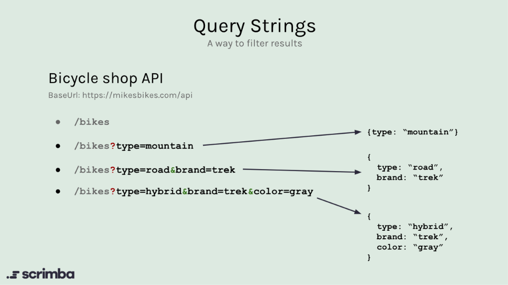

</details>

### 🗺️ Query String Architecture & Anatomy

<details>
  <summary><b>📷 Expand to View Query String Anatomy & Parsing Diagram</b></summary>
  <br>

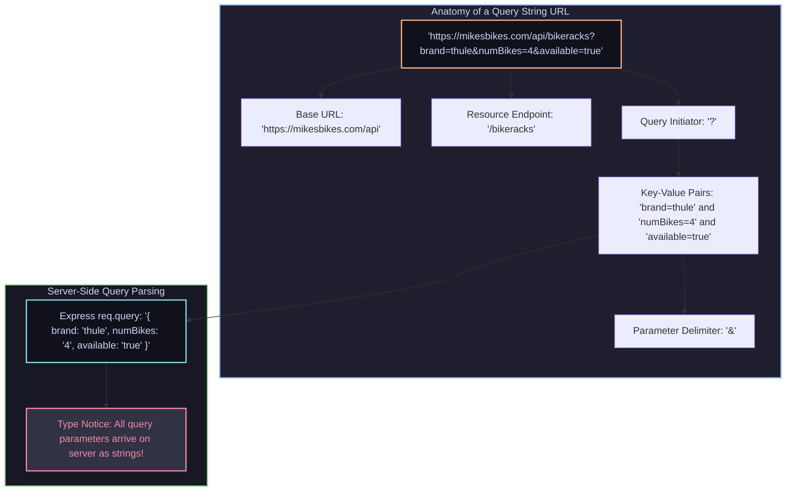

</details>

### 💡 Query Strings Recap & Quiz

Practice questions from [quiz.md](file:///c:/Users/suyas/Downloads/CODING%281%29/NEXTGEN-CODE/05-07-2026/APIs%20and%20Async%20JavaScript/URLs%20and%20REST/Query%20Strings/quiz.md):

> [!NOTE]
> **Base Collection Endpoint:**  
> To retrieve the complete inventory of all bike racks sold on the site, use the unadorned collection endpoint:  
> **`/bikeracks`**

> [!IMPORTANT]
> **Boolean Filters & String Parsing:**  
> To fetch only bike racks currently in stock at the physical store:  
> **`/bikeracks?available=true`**  
> Remember: The server parses `{ available: "true" }` as a string, requiring coercion before evaluating as a boolean!

> [!TIP]
> **Multi-Attribute Filtering:**  
> When combining multiple filter attributes (e.g. brand "Thule" and capacity for 4 bikes), separate each key-value pair with an ampersand (`&`):  
> **`/bikeracks?brand=thule&numBikes=4`**

### 💻 Code Implementation & Practice

Practice files for this chapter are available in [Query Strings](file:///c:/Users/suyas/Downloads/CODING%281%29/NEXTGEN-CODE/05-07-2026/APIs%20and%20Async%20JavaScript/URLs%20and%20REST/Query%20Strings) ([quiz.md](file:///c:/Users/suyas/Downloads/CODING%281%29/NEXTGEN-CODE/05-07-2026/APIs%20and%20Async%20JavaScript/URLs%20and%20REST/Query%20Strings/quiz.md)):

```javascript
// Query Strings Demonstration: Filtering Resources
const baseUrl = "https://mikesbikes.com/api";

// 1. Unfiltered: All bike racks
fetch(`${baseUrl}/bikeracks`)
    .then(res => res.json())
    .then(racks => console.log("All bike racks:", racks));

// 2. Single Filter: In-store available bike racks
fetch(`${baseUrl}/bikeracks?available=true`)
    .then(res => res.json())
    .then(inStock => console.log("In-store racks:", inStock));

// 3. Multi-Filter: Thule racks holding 4 bikes
fetch(`${baseUrl}/bikeracks?brand=thule&numBikes=4`)
    .then(res => res.json())
    .then(thule4 => console.log("Thule 4-bike racks:", thule4));

// 4. Modern Best Practice: Building Query Strings with URLSearchParams
const params = new URLSearchParams({
    type: "hybrid",
    brand: "trek",
    color: "gray"
});

fetch(`${baseUrl}/bikes?${params.toString()}`)
    .then(res => res.json())
    .then(results => console.log("Filtered Trek bikes:", results));
```

### 🔗 Chapter 34 Resources

- 📄 **MDN Web Docs:** [URLSearchParams API](https://developer.mozilla.org/en-US/docs/Web/API/URLSearchParams) — Standard interface for defining and working with query string parameters.
- 📄 **RFC 3986:** [Uniform Resource Identifier (URI): Generic Syntax](https://datatracker.ietf.org/doc/html/rfc3986#section-3.4) — The authoritative RFC specification for URI query components.
- 📄 **REST API Tutorial:** [REST Query Parameters & Filtering](https://restfulapi.net/rest-api-design-tutorial-with-example/) — Best practices for implementing query strings for search, pagination, and sorting.

---

## 🌦️ Chapter 35: Query String Practice - OpenWeatherMap API

Applying query strings to real-world weather endpoints allows developers to dynamically search locations and configure data formats, such as converting temperatures from Kelvin to human-readable units.

### 🔑 Core Concepts

1. **Location Targeting with Query Strings:**
   - **City Search (`?q={cityName}`):** Passes the target city name directly in the query (e.g. `?q=salt lake city` or `?q=London`).
   - **Geographic Coordinates (`?lat={lat}&lon={lon}`):** Pinpoints precise locations via latitude and longitude.
2. **Measurement Systems via `units` Parameter:**
   - By default, OpenWeatherMap returns temperatures in **Standard Kelvin** (e.g., `temp: 299.87`).
   - Passing `units=metric` converts temperatures to **Celsius (°C)** and wind speeds to meters/sec.
   - Passing `units=imperial` converts temperatures to **Fahrenheit (°F)** and wind speeds to miles/hour.
3. **Chaining Multiple Parameters (`&`):**
   - Query strings combine multiple options with ampersands: `?q=salt lake city&units=metric`.
4. **Proxy vs. Direct API Authentication:**
   - **Scrimba Proxy (`apis.scrimba.com`):** Injects authentication server-side, eliminating the need to expose client API keys during practice.
   - **Direct API (`api.openweathermap.org`):** Requires passing your registered API key via `&appid={YOUR_API_KEY}`.

### 💡 Visualizations

<details>
  <summary><b>📷 Expand to View Query String Diagram</b></summary>
  <br>

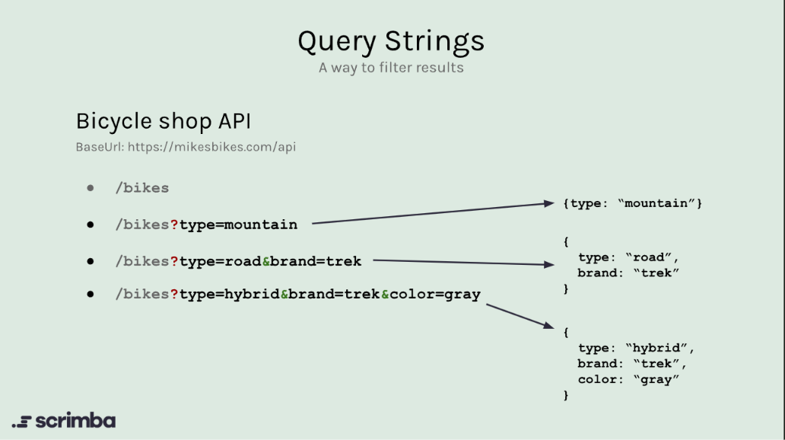

</details>

### 🗺️ Weather Query Parameter Architecture

<details>
  <summary><b>📷 Expand to View Weather Query Flow Diagram</b></summary>
  <br>

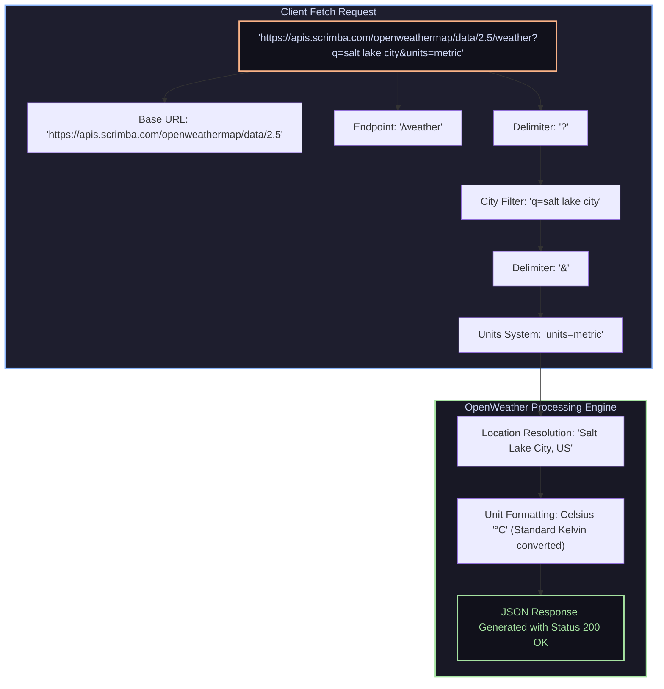

</details>

### 📝 Challenge & Recap

Practice file: [index.js](file:///c:/Users/suyas/Downloads/CODING%281%29/NEXTGEN-CODE/05-07-2026/APIs%20and%20Async%20JavaScript/URLs%20and%20REST/Query%20String%20Practice%20-%20OpenWeatherMap%20API/index.js)

> [!NOTE]
> **How do you query weather by city name instead of geographic coordinates?**  
> Use the `q` query parameter: `?q=London` or `?q=salt lake city`.

> [!TIP]
> **Why does OpenWeatherMap return temperatures like `299.87` by default?**  
> OpenWeatherMap defaults to **Kelvin**. Add `&units=metric` for Celsius or `&units=imperial` for Fahrenheit to convert the data.

> [!IMPORTANT]
> **Why can we omit `appid` when querying Scrimba's proxy?**  
> Scrimba's proxy URL (`https://apis.scrimba.com/...`) handles API key injection automatically in the backend. When making production calls directly to `api.openweathermap.org`, an `appid` parameter is mandatory.

### 💻 Code Implementation

Explore the project implementation in [Query String Practice - OpenWeatherMap API](file:///c:/Users/suyas/Downloads/CODING%281%29/NEXTGEN-CODE/05-07-2026/APIs%20and%20Async%20JavaScript/URLs%20and%20REST/Query%20String%20Practice%20-%20OpenWeatherMap%20API) ([index.js](file:///c:/Users/suyas/Downloads/CODING%281%29/NEXTGEN-CODE/05-07-2026/APIs%20and%20Async%20JavaScript/URLs%20and%20REST/Query%20String%20Practice%20-%20OpenWeatherMap%20API/index.js)):

```javascript
// Querying OpenWeatherMap via Scrimba Proxy with city and units parameters
fetch("https://apis.scrimba.com/openweathermap/data/2.5/weather?q=salt lake city&units=metric")
    .then(res => res.json())
    .then(data => {
        console.log(`Weather in ${data.name}:`);
        console.log(`Condition: ${data.weather[0].description}`);
        console.log(`Temperature: ${data.main.temp}°C`);
    });
```

### 🔗 Chapter 35 Resources

- 📄 **OpenWeatherMap Documentation:** [Current Weather Data API](https://openweathermap.org/current) — Parameter reference for `q`, `lat`, `lon`, and `units`.
- 📄 **OpenWeatherMap FAQ:** [Temperature Units FAQ](https://openweathermap.org/faq#error401) — Kelvin, Metric, and Imperial unit specifications.
- 📄 **MDN Web Docs:** [Query Strings and Fetching](https://developer.mozilla.org/en-US/docs/Web/API/Fetch_API/Using_Fetch) — Building dynamic API requests with JavaScript.


---

## 🎯 Chapter 36: URLs & REST Section Recap

The **URLs & REST** section marks a major milestone in mastering modern web development. Throughout this module, we transitioned from simple fetch queries to building a complete, interactive full-stack client application (**BlogSpace**) that queries, consumes, and publishes data across the web.

### 🔑 Core Concepts Recap

1. **HTTP Requests Anatomy:**
   - **URLs & Endpoints:** The exact web address and target path pointing to where resources live on a server.
   - **HTTP Verbs (Methods):** Expressing our client's intent:
     - `GET`: Retrieve data without modifying server state.
     - `POST`: Create and send new resources to the server.
     - `PUT`: Completely replace an existing resource.
     - `PATCH`: Apply partial modifications to a resource.
     - `DELETE`: Permanently remove a resource from the server.
   - **Request Body:** The data payload sent along with state-altering methods (`POST`, `PUT`, `PATCH`), serialized into a standard string format via `JSON.stringify()`.
   - **Headers:** Key-value pairs providing vital metadata to the server, such as specifying our payload type (`"Content-Type": "application/json"`) or delivering authorization credentials.

2. **REST (Representational State Transfer) Architecture:**
   - **Resources:** Concrete nouns representing data entities and collections (e.g. `/posts`, `/comments`, `/users`).
   - **URL Parameters:** Hierarchical path identifiers embedded directly in the URL to target specific unique entities (e.g. `/posts/1`) or parent-child associations (`/posts/1/comments`).
   - **Query Strings:** Optional key-value parameters initiated with `?` and chained with `&` to filter, search, sort, or paginate collections (e.g. `/bikeracks?available=true&numBikes=4`, `?q=London&units=metric`) without changing the base endpoint.

3. **The BlogSpace Application Milestone:**
   - Built a complete, two-way interactive web app from scratch.
   - **Reading Data (`GET`):** Pulled the latest posts from the API and rendered clean, responsive cards in the DOM.
   - **Writing Data (`POST`):** Captured user inputs from a form, prevented default browser submission with `e.preventDefault()`, dispatched a `POST` request with JSON data and headers, and prepended the newly created post (`postsArray.unshift(post)`) for instantaneous UI updates.

4. **Graduating from JSONPlaceholder:**
   - The **JSONPlaceholder API** served as an indispensable sandbox for exploring HTTP verbs, testing request configurations, and practicing data manipulation without setting up custom backend databases.
   - **The Mock Limitation:** JSONPlaceholder simulates successful creations by returning simulated IDs, but it does **not** persist data permanently. Real-world applications require connecting to persistent databases or third-party cloud backends (like Firebase or PostgreSQL).

### 💡 Visualizations & Slides

<details>
  <summary><b>📷 Expand to View Section Recap Slides & Reference Guides</b></summary>
  <br>

### 1. Topics Covered (HTTP Requests & REST APIs)

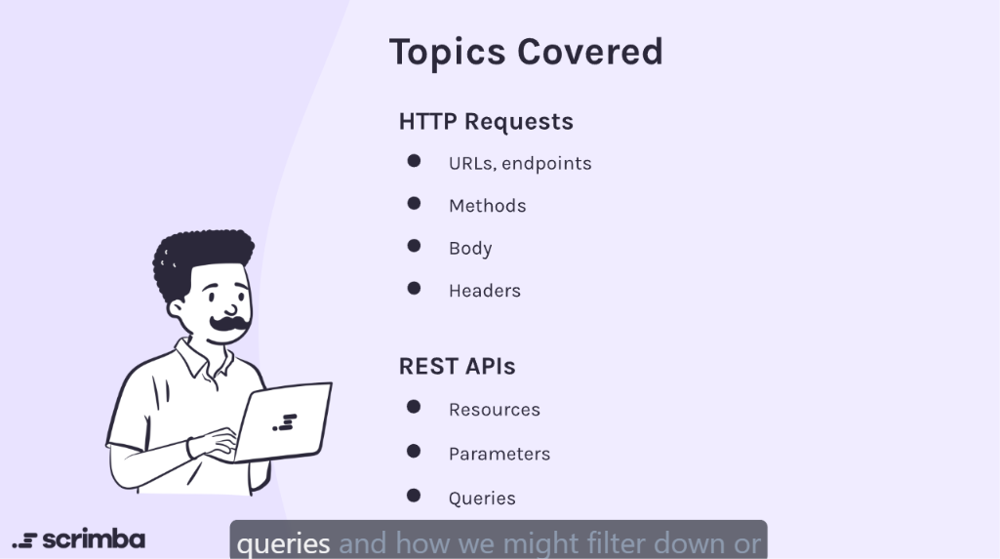

### 2. Recommended Learning Resources

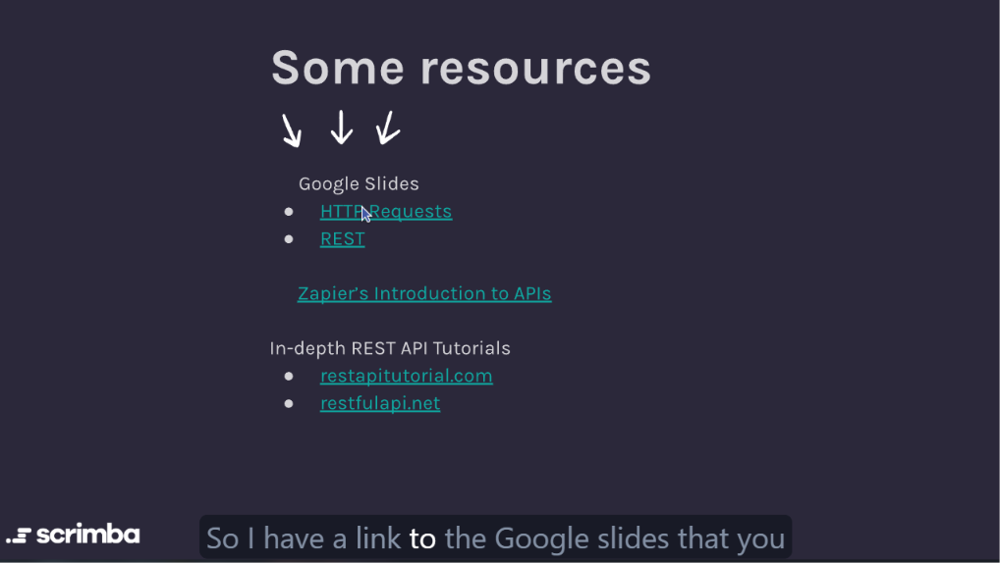

</details>

### 🗺️ Full HTTP Request & REST Architecture Lifecycle

<details>
  <summary><b>📷 Expand to View Comprehensive HTTP & REST Flow Diagram</b></summary>
  <br>


</details>

### 📝 Key Takeaways & Developer Reflections

> [!NOTE]
> **HTTP Request Structure:**  
> Every HTTP request is assembled from four pillars: an **Endpoint URL**, a **Method (Verb)** declaring action, optional **Headers** providing metadata context, and an optional **Body** transmitting payload data.

> [!TIP]
> **Overcoming Imposter Syndrome with API Fundamentals:**  
> Understanding how the Internet and client-server systems pass messages is often the pivotal moment when web engineering transitions from seeming like magic to being completely comprehensible. Mastering requests and responses gives you the confidence to interact with any web service or API in the industry.

> [!IMPORTANT]
> **REST Naming Convention Standards:**  
> Always model endpoints around **plural nouns** (`/posts`, `/users`, `/comments`). Rely on the HTTP method (`GET`, `POST`, `PUT`, `DELETE`) to dictate the action, keeping URLs clean, intuitive, and predictable.

### 💻 Code Implementation

Explore the complete recap implementation in [Section Recap](file:///c:/Users/suyas/Downloads/CODING%281%29/NEXTGEN-CODE/05-07-2026/APIs%20and%20Async%20JavaScript/URLs%20and%20REST/Section%20Recap) ([index.js](file:///c:/Users/suyas/Downloads/CODING%281%29/NEXTGEN-CODE/05-07-2026/APIs%20and%20Async%20JavaScript/URLs%20and%20REST/Section%20Recap/index.js), [index.html](file:///c:/Users/suyas/Downloads/CODING%281%29/NEXTGEN-CODE/05-07-2026/APIs%20and%20Async%20JavaScript/URLs%20and%20REST/Section%20Recap/index.html), [index.css](file:///c:/Users/suyas/Downloads/CODING%281%29/NEXTGEN-CODE/05-07-2026/APIs%20and%20Async%20JavaScript/URLs%20and%20REST/Section%20Recap/index.css)):

```javascript
// Complete GET and POST Cycle with In-Memory Array Sync
let postsArray = [];
const form = document.getElementById("new-post");

// 1. Initial GET Request: Fetch existing posts
fetch("https://apis.scrimba.com/jsonplaceholder/posts")
    .then(res => res.json())
    .then(data => {
        postsArray = data.slice(0, 5);
        renderPosts();
    });

// 2. Submitting New Resource via POST Request
form.addEventListener("submit", function(e) {
    e.preventDefault();
    const data = {
        title: document.getElementById("post-title").value,
        body: document.getElementById("post-body").value
    };

    fetch("https://apis.scrimba.com/jsonplaceholder/posts", {
        method: "POST",
        body: JSON.stringify(data),
        headers: { "Content-Type": "application/json" }
    })
        .then(res => res.json())
        .then(post => {
            postsArray.unshift(post); // Prepend new post for immediate feedback
            renderPosts();
            form.reset();
        });
});
```

### 🔗 Chapter 36 Resources

- 📊 **Google Slides (HTTP Requests):** [HTTP Requests Interactive Slides](https://docs.google.com/presentation/d/e/2PACX-1vSxS5iMjTveO-IBqdDE65dgouZStLTW-Vlyt3N9js3FnMCeW8cwSgmrkGzX2i_g0qGCM6fJDKZ-r3Se/pub?start=false&loop=false&delayms=3000&slide=id.g7fabbaef24_1_232) — Visual walk-through of URLs, endpoints, methods, bodies, and headers.
- 📊 **Google Slides (REST):** [REST Architecture & Design Slides](https://docs.google.com/presentation/d/e/2PACX-1vTEztADtG8OhJ4695LYwtVftNgriQK7zAOsYNru9OfaPA1mQEAlkNd1BqgOdec1aZRC6PxSxOnlrBeH/pub?start=false&loop=false&delayms=3000&slide=id.g7fabbaef24_1_232) — Principles of resources, path parameters, and query strings.
- 📄 **Zapier API Guide:** [Zapier's Introduction to APIs](https://zapier.com/resources/guides/apis) — The legendary beginner guide that demystifies how the internet and APIs work, perfect for cutting through imposter syndrome.
- 📄 **REST API Tutorial:** [In-depth REST API Tutorials](https://www.restapitutorial.com/) — Deep-dive covering REST constraints, HTTP status codes, and idempotency.
- 📄 **RESTful API Net:** [RESTful API Design Standards](https://restfulapi.net/) — Industry-standard architectural guidelines for enterprise RESTful services.

---

## 🎨 Chapter 37: Solo Project - Color Scheme Generator

The **Color Scheme Generator** is an interactive, responsive web application that generates harmonious 5-color palettes based on any seed color and harmony mode selected by the user, querying **The Color API** via RESTful query strings and incorporating asynchronous clipboard copying.

### 🔑 Core Concepts

1. **REST Query String Construction with The Color API:**
   - **Base Endpoint:** `https://www.thecolorapi.com/scheme`
   - **Parameter Sanitization:** Native HTML5 color inputs return a hex code with a leading hash (e.g. `#2563EB`). The API expects raw hex strings, requiring `color.slice(1)` before building query strings.
   - **Query Parameters:**
     - `hex`: The sanitized seed color (e.g. `000000`, `2563EB`).
     - `mode`: The mathematical color harmony formula (`monochrome`, `monochrome-dark`, `monochrome-light`, `complement`, `analogic-complement`, `triad`).
     - `count`: The number of colors generated in the palette (e.g. `count=5`).
   - **Constructed URL:** `https://www.thecolorapi.com/scheme?hex=${color}&mode=${mode}&count=5`

2. **CSS Grid Swatch Layout:**
   - Palettes are structured using a modern 5-column CSS Grid: `grid-template-columns: repeat(5, minmax(0, 1fr))`.
   - Each column encapsulates a vertical color swatch block (`.color-swatch`) with dynamic background styling and an uppercase hexadecimal code label (`.color-hex`).

3. **Event Delegation Pattern:**
   - Rather than binding individual event listeners to each dynamically rendered color swatch, a single `click` event listener is mounted to the parent container (`#color-container`).
   - Using `e.target.closest(".color-column")?.dataset.hex` guarantees that clicks anywhere within a swatch column reliably retrieve the intended hex code.

4. **Asynchronous Clipboard API & Feedback UX:**
   - Utilizes the modern browser `navigator.clipboard.writeText(hex)` method to write the color code directly into the user's system clipboard upon clicking.
   - Triggers a transient "Copied" toast notification that automatically dismisses after 1.5 seconds via `setTimeout()`.

### 🗺️ Application Architecture & Data Flow

<details>
  <summary><b>📷 Expand to View Color Scheme Generator Flow Diagram</b></summary>
  <br>


</details>

### 📝 Key Takeaways & Review

> [!NOTE]
> **Why strip the leading `#` character before querying The Color API?**  
> In URI specifications, the `#` symbol designates a URL fragment identifier (hash anchor). If included unencoded inside a query parameter (`?hex=#ffffff`), the browser interprets everything after `#` as a client-side fragment rather than sending it to the server! Using `.slice(1)` removes the `#` and ensures proper parameter transmission.

> [!TIP]
> **Event Delegation for Dynamic Content:**  
> When elements are repeatedly destroyed and re-rendered via `innerHTML`, attaching event listeners directly to individual children leads to memory leaks or lost listeners. Attaching one listener to the persistent parent (`#color-container`) and leveraging `e.target.closest()` ensures robust handling across all re-renders.

> [!IMPORTANT]
> **Clipboard API Security Constraints:**  
> `navigator.clipboard.writeText()` is asynchronous and returns a Promise. For security reasons, modern browsers only permit clipboard writes when triggered by a direct, trusted user gesture (such as a click event).

### 💻 Code Implementation

Explore the project implementation in [Solo Project - Color Scheme Generator](file:///c:/Users/suyas/Downloads/CODING%281%29/NEXTGEN-CODE/05-07-2026/APIs%20and%20Async%20JavaScript/Solo%20Project%20-%20Color%20Scheme%20Generator) ([index.js](file:///c:/Users/suyas/Downloads/CODING%281%29/NEXTGEN-CODE/05-07-2026/APIs%20and%20Async%20JavaScript/Solo%20Project%20-%20Color%20Scheme%20Generator/index.js), [index.html](file:///c:/Users/suyas/Downloads/CODING%281%29/NEXTGEN-CODE/05-07-2026/APIs%20and%20Async%20JavaScript/Solo%20Project%20-%20Color%20Scheme%20Generator/index.html), [index.css](file:///c:/Users/suyas/Downloads/CODING%281%29/NEXTGEN-CODE/05-07-2026/APIs%20and%20Async%20JavaScript/Solo%20Project%20-%20Color%20Scheme%20Generator/index.css)):

```javascript
// Color Scheme Generator: Fetching palette and handling clipboard interaction
const btn = document.getElementById("get-scheme");

function getColors() {
    const color = document.getElementById("seed-color").value.slice(1);
    const mode = document.getElementById("scheme-mode").value;

    fetch(`https://www.thecolorapi.com/scheme?hex=${color}&mode=${mode}&count=5`)
        .then(res => res.json())
        .then(data => {
            let html = "";
            data.colors.forEach(color => {
                html += `
                    <div class="color-column" data-hex="${color.hex.value}">
                        <div class="color-swatch" style="background-color: ${color.hex.value}"></div>
                        <div class="color-hex">${color.hex.value}</div>
                    </div>
                `;
            });
            document.getElementById("color-container").innerHTML = html;
        });
}

// Initial fetch & event listener
btn.addEventListener("click", getColors);
getColors();

// Event Delegation for Copy to Clipboard
document.getElementById("color-container").addEventListener("click", e => {
    const hex = e.target.closest(".color-column")?.dataset.hex;
    if (hex) {
        navigator.clipboard.writeText(hex);
        const msg = document.getElementById("copy-msg");
        msg.textContent = "Copied";
        setTimeout(() => { msg.textContent = ""; }, 1500);
    }
});
```

### 🔗 Chapter 37 Resources

- 📄 **The Color API Documentation:** [The Color API Reference](https://www.thecolorapi.com/docs) — Scheme endpoints, modes, color conversion schemas, and query syntax.
- 📄 **MDN Web Docs:** [Clipboard API](https://developer.mozilla.org/en-US/docs/Web/API/Clipboard_API) — Interacting with system clipboard asynchronously.
- 📄 **MDN Web Docs:** [Event Delegation & Closest](https://developer.mozilla.org/en-US/docs/Web/API/Element/closest) — Handling dynamic element events via DOM tree traversal.
- 📄 **MDN Web Docs:** [CSS Grid Layout Guide](https://developer.mozilla.org/en-US/docs/Web/CSS/CSS_Grid_Layout) — Responsive multi-column layout architectures.

---

## 🃏 Chapter 38: Async JavaScript Intro & War Project

Asynchronous programming is the cornerstone of responsive web applications. This chapter dives into the fundamental mechanics of **Synchronous vs. Asynchronous execution**, the single-threaded nature of JavaScript, and begins the **Game of War** project leveraging the **Deck of Cards API**.

### 🔑 Core Concepts

1. **Synchronous JavaScript (The Default Execution Model):**
   - Code executes sequentially, line-by-line, from top to bottom.
   - Each command must complete fully before the next instruction can begin.
   - **Blocking Nature:** If an operation takes time (e.g. heavy computation or network latency), the browser interface freezes because no two commands can execute simultaneously on the main thread.

2. **Asynchronous JavaScript ("Out-of-Order" Execution):**
   - Allows long-running tasks (such as network requests or timers) to start and run in the background without blocking the execution of subsequent code.
   - Network responses take time (e.g. 145ms to several seconds). Rather than freezing, JavaScript registers a callback / promise handler (`.then()`) and continues executing other tasks immediately.

3. **The Real-World Pasta Boiling Analogy:**
   - **Synchronous:** Putting a pot of water on the stove and standing frozen in place doing nothing until the water boils.
   - **Asynchronous:** Putting the pot on the stove, turning on the burner, and chopping vegetables or prepping sauce while the water boils. When the water finishes boiling, you return to add the pasta.

4. **Single-Threaded Architecture & Callbacks:**
   - JavaScript is strictly **single-threaded**—it possesses only one call stack and can only process one command at any given millisecond.
   - "Asynchronous" JavaScript is achieved through **Web APIs and the Event Loop**: the browser runtime handles asynchronous tasks in background worker threads, queuing callbacks into the task queue to run once the main call stack becomes empty.

5. **Evolution of Asynchronous JavaScript:**
   - **Callbacks:** The foundational mechanism for deferred execution.
   - **Promises:** Elegant abstraction and syntactic sugar over callbacks (`.then()` and `.catch()`).
   - **Async / Await:** Modern syntactic sugar built on top of Promises for writing asynchronous code that reads like synchronous code.

6. **The Game of War Architecture:**
   - **State Persistence:** Storing `deckId` across fetch calls to draw cards from the same shuffled deck.
   - **Card Hierarchy Evaluation:** Determining the round winner by mapping string card values (`"2"` through `"ACE"`) to their indices in a ranked array:
     ```javascript
     const valueOptions = ["2", "3", "4", "5", "6", "7", "8", "9", "10", "JACK", "QUEEN", "KING", "ACE"];
     const card1ValueIndex = valueOptions.indexOf(card1.value);
     ```
   - **End Game Condition:** Detecting when `data.remaining === 0`, disabling the draw trigger, and evaluating final match scores.

### 💡 Visualizations & Slides

<details>
  <summary><b>📷 Expand to View Async JavaScript Visual Slides & Analogies</b></summary>
  <br>

### 1. Introduction to Asynchronous JavaScript


### 2. Synchronous JavaScript (Sequential & Blocking)


### 3. Asynchronous JavaScript (Non-Blocking & Out of Order)


### 4. Real-World Analogy: Boiling Pasta


### 5. Why "Asynchronous"? Single-Threaded Mechanics


### 6. Roadmap: Callbacks, Promises, Async/Await & War Project


</details>

### 🗺️ Execution Models & War Game Architecture

<details>
  <summary><b>📷 Expand to View Execution Models & War Flow Diagram</b></summary>
  <br>


</details>

### 📝 Key Takeaways & Review

> [!NOTE]
> **What makes code synchronous?**  
> In synchronous execution, every command must complete before the next command can run. No two commands can execute at the exact same time.

> [!TIP]
> **How does JavaScript handle long tasks despite being single-threaded?**  
> JavaScript offloads long I/O operations (like `fetch` and `setTimeout`) to the browser runtime (Web APIs). When the task finishes, its callback is pushed to the task queue and executed by the **Event Loop** once the call stack is clear.

> [!IMPORTANT]
> **Card Ranking via Array Indexing:**  
> Since card values include face cards (`"JACK"`, `"QUEEN"`, `"KING"`, `"ACE"`), string or numeric casting fails. Mapping them to an array (`valueOptions`) allows using `indexOf()` to perform clean numerical comparisons:
> ```javascript
> if (card1ValueIndex > card2ValueIndex) { /* Player 1 wins */ }
> ```

### 💻 Code Implementation

Explore the implementation in [Async JS Intro & War Project](file:///c:/Users/suyas/Downloads/CODING%281%29/NEXTGEN-CODE/05-07-2026/APIs%20and%20Async%20JavaScript/Async%20JavaScript/Async%20JS%20Intro%20&%20War%20Project) ([index.js](file:///c:/Users/suyas/Downloads/CODING%281%29/NEXTGEN-CODE/05-07-2026/APIs%20and%20Async%20JavaScript/Async%20JavaScript/Async%20JS%20Intro%20&%20War%20Project/index.js), [index.html](file:///c:/Users/suyas/Downloads/CODING%281%29/NEXTGEN-CODE/05-07-2026/APIs%20and%20Async%20JavaScript/Async%20JavaScript/Async%20JS%20Intro%20&%20War%20Project/index.html), [index.css](file:///c:/Users/suyas/Downloads/CODING%281%29/NEXTGEN-CODE/05-07-2026/APIs%20and%20Async%20JavaScript/Async%20JavaScript/Async%20JS%20Intro%20&%20War%20Project/index.css)):

```javascript
// Game of War: Shuffling deck and drawing cards asynchronously
let deckId;
let computerScore = 0;
let myScore = 0;

// 1. Initialize Shuffled Deck
function getNewDeck() {
    fetch("https://apis.scrimba.com/deckofcards/api/deck/new/shuffle/")
        .then(res => res.json())
        .then(data => {
            deckId = data.deck_id;
            document.getElementById("remaining").textContent = `Remaining cards: ${data.remaining}`;
        });
}

// 2. Draw Cards and Evaluate Round Winner
function drawCards() {
    fetch(`https://apis.scrimba.com/deckofcards/api/deck/${deckId}/draw/?count=2`)
        .then(res => res.json())
        .then(data => {
            document.getElementById("remaining").textContent = `Remaining cards: ${data.remaining}`;
            document.getElementById("cards").children[0].innerHTML = ``;
            document.getElementById("cards").children[1].innerHTML = ``;
            
            const winnerText = determineCardWinner(data.cards[0], data.cards[1]);
            document.getElementById("header").textContent = winnerText;
            
            if (data.remaining === 0) {
                document.getElementById("draw-cards").disabled = true;
                document.getElementById("header").textContent = 
                    computerScore > myScore ? "The computer won the game!" :
                    myScore > computerScore ? "You won the game!" : "It's a tie game!";
            }
        });
}

// 3. Card Value Comparison Logic
function determineCardWinner(card1, card2) {
    const valueOptions = ["2", "3", "4", "5", "6", "7", "8", "9", "10", "JACK", "QUEEN", "KING", "ACE"];
    const card1ValueIndex = valueOptions.indexOf(card1.value);
    const card2ValueIndex = valueOptions.indexOf(card2.value);
    
    if (card1ValueIndex > card2ValueIndex) {
        computerScore++;
        document.getElementById("computer-score").textContent = `Computer score: ${computerScore}`;
        return "Computer wins!";
    } else if (card1ValueIndex < card2ValueIndex) {
        myScore++;
        document.getElementById("my-score").textContent = `My score: ${myScore}`;
        return "You win!";
    } else {
        return "War!";
    }
}
```

### 🔗 Chapter 38 Resources

- 📄 **Deck of Cards API Documentation:** [Deck of Cards API Reference](https://deckofcardsapi.com/) — Shuffling, drawing, and card object schemas.
- 📄 **MDN Web Docs:** [Introducing Asynchronous JavaScript](https://developer.mozilla.org/en-US/docs/Learn/JavaScript/Asynchronous/Introducing) — Comprehensive guide to synchronous vs asynchronous code.
- 📄 **MDN Web Docs:** [Concurrency Model and the Event Loop](https://developer.mozilla.org/en-US/docs/Web/JavaScript/Event_loop) — Understanding the call stack, Web APIs, and task queue.
