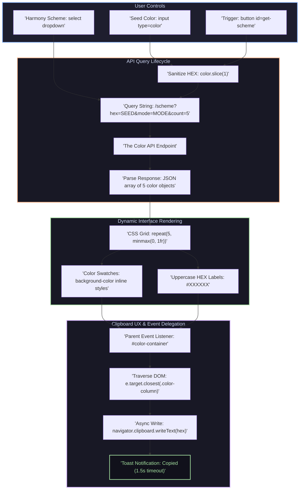

# 🎨 Color Scheme Generator

A sleek, responsive, and interactive web application that generates harmonious 5-color palettes based on a selected seed color and color harmony scheme. Built with modern JavaScript, CSS Grid, and **The Color API**, featuring dynamic DOM rendering and one-click clipboard copying.

---

## ⚡ Features

- **🎯 Interactive Color Picker:** Choose any base color using the native HTML5 `<input type="color">`.
- **🔄 Multiple Color Harmony Modes:** Select from 6 mathematical harmony algorithms:
  - `Monochrome`
  - `Monochrome-dark`
  - `Monochrome-light`
  - `Complement`
  - `Analogic-complement`
  - `Triad`
- **🌐 REST API Integration:** Asynchronously queries **The Color API** using parameterized query strings (`hex`, `mode`, `count`).
- **📊 Dynamic CSS Grid Swatches:** Automatically renders a 5-column color palette with reactive height and uppercase HEX codes.
- **📋 One-Click Copy to Clipboard:** Click any color column to copy its HEX value straight to the clipboard via the asynchronous `navigator.clipboard` API.
- **💬 Visual Feedback Toast:** Displays a clean, temporary "Copied" alert that automatically dismisses after 1.5 seconds.
- **📱 Fully Responsive Design:** Clean mobile-optimized layout using CSS media queries and flexible viewport units.

---

## 🗺️ Architecture & Data Flow

<details>
  <summary><b>📷 Expand to View Application Data Flow Diagram</b></summary>
  <br>



</details>

---

## 🛠️ Tech Stack & Key Concepts

| Technology / Pattern | Role & Implementation |
|:---|:---|
| **JavaScript (ES6+)** | Dynamic fetch requests, promise chaining, event delegation, and clipboard operations |
| **The Color API** | External REST API service generating harmonious color collections |
| **CSS Grid & Flexbox** | Responsive multi-column layout for palettes and header controls |
| **Clipboard API** | Asynchronous system clipboard integration (`navigator.clipboard.writeText`) |
| **Event Delegation** | Single click listener on container using `e.target.closest()` |
| **Vite** | Lightning-fast development server and module bundler |

---

## 💻 Code Highlights

### 1. Sanitizing HEX Values for Query Strings
HTML color inputs provide hex codes prefixed with `#` (e.g. `#2563eb`). In URLs, the `#` symbol designates a fragment identifier. Using `.slice(1)` removes the `#` so it transmits correctly as a query parameter:

```javascript
const color = document.getElementById("seed-color").value.slice(1);
const mode = document.getElementById("scheme-mode").value;

fetch(`https://www.thecolorapi.com/scheme?hex=${color}&mode=${mode}&count=5`)
    .then(res => res.json())
    .then(data => {
        // Render 5 color swatches dynamically
    });
```

### 2. Event Delegation for Click-to-Copy
Instead of binding separate listeners to each newly created DOM element, a single event listener is attached to the parent container:

```javascript
document.getElementById("color-container").addEventListener("click", e => {
    const hex = e.target.closest(".color-column")?.dataset.hex;
    if (hex) {
        navigator.clipboard.writeText(hex);
        const msg = document.getElementById("copy-msg");
        msg.textContent = "Copied";
        
        setTimeout(() => {
            msg.textContent = "";
        }, 1500);
    }
});
```

---

## 📁 Project Structure

```
Solo Project - Color Scheme Generator/
├── index.html         # Semantic HTML markup (header controls, main palette container, copy toast)
├── index.js           # Fetch API logic, DOM rendering loop, and event delegation
├── index.css          # Responsive design, CSS Grid layout, swatch styling, and media queries
├── vite.config.js     # Vite configuration
├── package.json       # Dependencies and development scripts
└── README.md          # Comprehensive project documentation
```

---

## 🚀 Getting Started

### Prerequisites
- Node.js (v16.0 or higher)
- npm or yarn

### Installation & Run

1. Navigate to the project directory:
   ```bash
   cd "Solo Project - Color Scheme Generator"
   ```

2. Install dependencies:
   ```bash
   npm install
   ```

3. Start the Vite local development server:
   ```bash
   npm start
   # or
   npm run dev
   ```

4. Open your browser and navigate to `http://localhost:5173/` (or the URL displayed in your terminal).

---

## 🔗 Useful Resources

- 📄 **The Color API Docs:** [The Color API Reference](https://www.thecolorapi.com/docs) — Scheme endpoints, modes, and query parameters.
- 📄 **MDN Web Docs:** [Clipboard API](https://developer.mozilla.org/en-US/docs/Web/API/Clipboard_API) — Modern asynchronous clipboard access.
- 📄 **MDN Web Docs:** [Element.closest()](https://developer.mozilla.org/en-US/docs/Web/API/Element/closest) — Traversing elements for robust event delegation.
- 📄 **MDN Web Docs:** [CSS Grid Layout](https://developer.mozilla.org/en-US/docs/Web/CSS/CSS_Grid_Layout) — Multi-column responsive layout design.